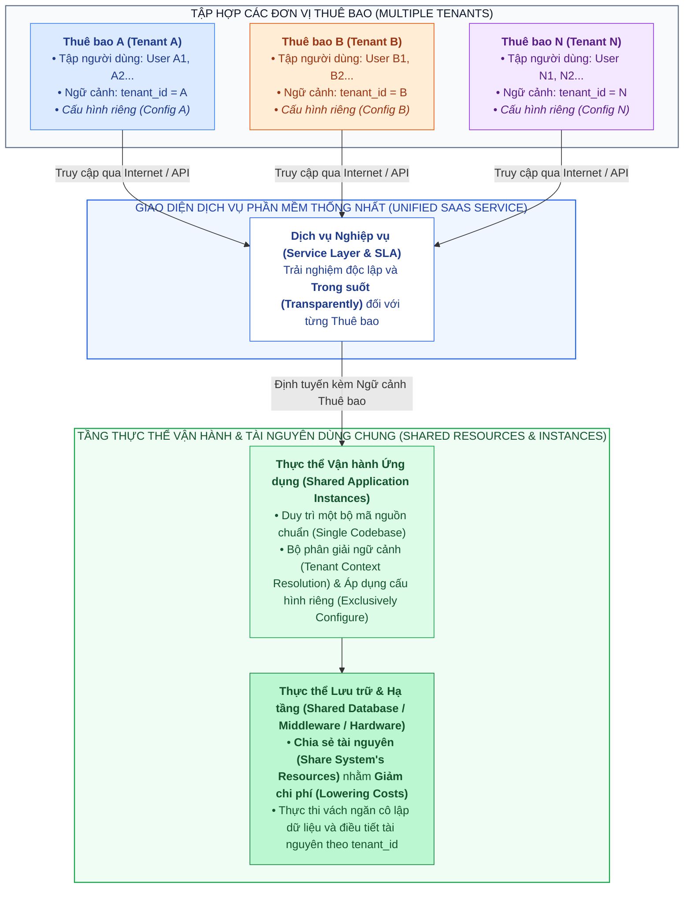

# **BÁO CÁO TỔNG HỢP ĐIỀU CHỈNH NỘI DUNG, KIỂM ĐỊNH HỆ THỐNG SƠ ĐỒ VÀ VĂN BẢN HOÀN CHỈNH CHƯƠNG 1**
# **ĐỀ TÀI NCKH: KIẾN TRÚC ĐA THUÊ BAO (MULTI-TENANT ARCHITECTURE) TRONG NỀN TẢNG SAAS KANBAN**

> **Tài liệu đầu vào sử dụng:**
> 1. `resources/Tong_ket_Toan_bo_Cuoc_tro_chuyen_va_Chuyen_giao_Boi_canh.md` *(Nạp toàn bộ bối cảnh học thuật và mạch logic 5 chương của đề tài)*.
> 2. `resources/nhanxet_chuong1.md` *(Định hướng cấu trúc, phương pháp luận và các yêu cầu chỉnh sửa chi tiết cho Chương 1)*.
> 3. `resources/Chuong_1_Co_so_ly_thuyet_va_Mo_hinh_hoa.md` *(Tài liệu tham khảo ý tưởng, số liệu trích dẫn và quy chuẩn ngôn ngữ khoa học khách quan)*.
> 4. `resources/noidung_chuong1.md` *(Bản thảo gốc được điều chỉnh và nâng cấp toàn diện)*.
> 5. `diagrams/diagrams_C1/` *(Hệ thống các tệp sơ đồ `.drawio`, `.png`, `.svg` của Chương 1 được kiểm định đối chiếu)*.

---

## **PHẦN I: BÁO CÁO TỔNG HỢP CÁC NỘI DUNG ĐÃ ĐIỀU CHỈNH VÀ TỐI ƯU HÓA CHO CHƯƠNG 1**

Thực hiện theo đúng định hướng trong tệp `nhanxet_chuong1.md` (bao gồm cả các chỉ đạo bổ sung trực tiếp tại dòng 24 và dòng 41) và tham khảo các ý tưởng chuẩn hóa từ `Chuong_1_Co_so_ly_thuyet_va_Mo_hinh_hoa.md`, bản thảo Chương 1 (`noidung_chuong1.md`) đã được tái cấu trúc và biên tập lại toàn diện. Dưới đây là chi tiết các hạng mục đã điều chỉnh:

### **1.1. Bảng Đối sánh Cấu trúc Chương 1 Trước và Sau Khi Điều chỉnh**

| Cấu trúc Cũ (`noidung_chuong1.md` ban đầu) | Cấu trúc Mới Hoàn thiện (Theo định hướng `nhanxet_chuong1.md`) | Bản chất và Ý nghĩa của Sự Điều chỉnh |
| :--- | :--- | :--- |
| *(Không có đoạn dẫn nhập chương)* | **Mở đầu Chương 1** *(Dẫn nhập bối cảnh & mạch lập luận diễn dịch – quy nạp)* | Tạo bước đệm học thuật dẫn dắt người đọc nắm bắt bức tranh tổng thể của toàn bộ Chương 1 trước khi đi vào từng mục. |
| **1. Tổng quan về SaaS và Động lực...** • `1.1.` Mô hình SaaS • `1.2.` Tiến trình Tiến hóa • `1.3.` Mối liên hệ Kinh tế - Kỹ thuật • `1.4.` Mô hình Chong & Carraro | **1. Tổng quan về SaaS và Động lực Hình thành Kiến trúc Đa thuê bao** • `1.1.` Mô hình SaaS và Tiến trình Tiến hóa của các Mô hình Chia sẻ Tài nguyên Điện toán *(Gộp 1.1 & 1.2 cũ)* • `1.2.` Động lực Kinh tế – Kỹ thuật và Mô hình Trưởng thành Kiến trúc SaaS (Chong & Carraro) *(Gộp 1.3 & 1.4 cũ)* | • Thực thi chỉ đạo tại dòng 41 của `nhanxet_chuong1.md`: cô đọng Mục 1 thành đúng **2 tiểu mục con**. • Trong `1.1`: Đi theo đúng mạch *Nguồn gốc (On-Premises) $\rightarrow$ Động lực ra đời $\rightarrow$ Vai trò (Utility Computing)* (mỗi ý 2–3 câu tách đoạn riêng) $\rightarrow$ *Định nghĩa chuẩn NIST SP 800-145* $\rightarrow$ *Lợi ích đối chiếu 2 phía trong 1 đoạn* $\rightarrow$ *Tiến trình 4 mốc lịch sử súc tích + Sơ đồ*. • Trong `1.2`: Kết nối trực tiếp nguyên lý *Ghép kênh thống kê* và hàm TCO với 4 cấp độ trưởng thành của Chong & Carraro; định vị đề tài ở Cấp độ 3 hướng tới Cấp độ 4. |
| **2. Định nghĩa và Sự phân kỳ góc nhìn...** • `2.1.` Khảo cứu Hệ thống (Kabbedijk) • `2.2.` Sự Phân kỳ Góc nhìn • `2.3.` Phân tích Tần suất Thuật ngữ *(Bảng trống)* • `2.4.` Định nghĩa Khoa học Chuẩn hóa | **2. Chuẩn hóa Khái niệm Nền tảng, Sự Phân kỳ Góc nhìn và Định nghĩa Đa thuê bao** • `2.1.` Chuẩn hóa Bộ ba Khái niệm Nền tảng: *Tenant – Service – Instance* *(Đưa từ 3.1 cũ lên)* • `2.2.` Khảo cứu Hệ thống và Sự Phân kỳ Góc nhìn giữa Giới Học thuật và Công nghiệp *(Gom 2.1 & 2.2 cũ)* • `2.3.` Định nghĩa Khoa học Chuẩn hóa về Đa thuê bao và Mô hình Khái niệm Tổng quát *(Từ 2.4 cũ + Sơ đồ mới)* | • **Đột phá phương pháp luận:** Đưa bộ ba *Tenant – Service – Instance* lên đầu Mục 2 làm hệ quy chiếu từ vựng trước khi phân tích sự phân kỳ góc nhìn. • Gom `2.1` và `2.2` cũ thành một mục súc tích, mạch lạc. • Loại bỏ hoàn toàn mục `2.3` cũ (bảng tần suất từ vựng bị bỏ trống/rườm rà), chỉ giữ lại 5 nguyên tắc định nghĩa của Copi & Miller để dẫn sang `2.3` mới. • Bổ sung **Sơ đồ Mô hình hóa Khái niệm Đa thuê bao Tổng quát (Hình 1.4)** gắn kết bộ ba khái niệm với 4 thuộc tính của Kabbedijk et al. (2015). |
| **3. Chuẩn hóa thuật ngữ và 5 đặc trưng...** • `3.1.` Bộ ba khái niệm • `3.2.` Năm đặc trưng (`3.2.1`, `3.2.2`, `3.3.3`, `3.3.4`, `3.3.5` – lỗi đánh số) | **3. Năm Đặc trưng Kiến trúc Cốt lõi của Hệ thống Đa thuê bao Hiện đại** • Đoạn dẫn nhập: *Multi-Tenancy như một Triết lý Kiến trúc Toàn diện* • `3.1.` Chia sẻ tài nguyên trong suốt • `3.2.` Khả năng tùy biến động lúc chạy dựa trên Siêu dữ liệu • `3.3.` Tính cô lập đa chiều giữa các Thuê bao • `3.4.` Khả năng co giãn, tự phục vụ và vận hành vòng đời liên tục • `3.5.` Dịch vụ được đo lường và giám sát mức tiêu thụ theo Thuê bao | • Sau khi chuyển `3.1` cũ lên `2.1`, Mục 3 tập trung trọn vẹn vào 5 đặc trưng kiến trúc cốt lõi. • Viết mới đoạn dẫn nhập khẳng định bản chất triết lý kiến trúc toàn diện của MT. • Sửa triệt để lỗi đánh số đề mục (`3.3.3` $\rightarrow$ `3.3`, v.v.) và lỗi chế bản (`"tự độn"` $\rightarrow$ `"tự động"`). • Bổ sung các đoạn dẫn chuyển ý giữa 5 đặc trưng và đoạn bàn luận tổng kết ở cuối Mục 3 để dẫn sang Mục 4. |
| **4. Phân biệt và mô hình hóa ST, MI, MU, MT** • `4.1.` Bản chất kỹ thuật của 4 mô hình • `4.2.` Bảng đối chiếu 8 tiêu chí dài dòng • `4.3.` Sơ đồ trực quan *(không có lời bình)* | **4. Phân biệt và Mô hình hóa các Khái niệm Dễ nhầm lẫn (ST, MI, MU, MT)** • `4.1.` Nguồn gốc của Sự Nhầm lẫn Khái niệm từ 5 Đặc trưng Kiến trúc và 3 Tiêu chí Phân định Bản chất • `4.2.` Sơ đồ Mô hình hóa Trực quan và Phân tích Bản chất Bốn Mô hình • `4.3.` Bàn luận Chuyên sâu về Sự Đánh đổi Kiến trúc và Đúc kết | • Đi trực tiếp từ 5 đặc trưng ở Mục 3 để giải thích lý do vì sao ST, MI, MU dễ bị nhầm lẫn với MT khi nhìn như "hộp đen". • Tổng quát hóa **3 Tiêu chí Cốt lõi**: *(1) Cấu trúc định danh 1 lớp vs 2 lớp; (2) Chia sẻ thực thể vận hành; (3) Cơ chế tùy biến lúc chạy*. • **Loại bỏ bảng `4.2` cũ** theo đúng yêu cầu; đưa Sơ đồ trực quan (Hình 1.5) lên làm trung tâm, kèm phân tích bản chất, bàn luận đánh đổi và đúc kết kiến trúc. |
| **5. Tái định nghĩa ngăn xếp hệ thống (Figure 2 mới) và Ranh giới Thuê bao** • `5.1.` Phân tích Figure 2 nguyên bản *(dài)* • `5.2.` Động lực dịch chuyển Cloud-Native • `5.3.` Định nghĩa chi tiết 9 tầng *(dài, đi sâu kỹ thuật)* • `5.4.` Đề xuất Ranh giới Thuê bao & Phổ Độ dày • `5.5.` Mô hình hóa tổng thể *(Đang để trống: `"vẽ sau"`)* | **5. Tái định nghĩa Ngăn xếp Hệ thống (Figure 2 Mới) và Khái niệm Ranh giới Thuê bao** • `5.1.` Phân tích Ngăn xếp Nguyên bản (Figure 2) và Giới hạn Lịch sử *(Cô đọng, làm rõ vai trò "Bản đồ giải phẫu học" & 2 giới hạn)* • `5.2.` Động lực Dịch chuyển Công nghệ và Đề xuất Mô hình Cập nhật Cloud-Native • `5.3.` Định nghĩa Trừu tượng 9 Tầng Thành phần *(Bảng tóm tắt + Diễn giải trừu tượng, dễ hiểu)* • `5.4.` Đề xuất Khái niệm "Ranh giới Thuê bao" và Phổ Độ dày Ranh giới (`5.4.1` $\rightarrow$ `5.4.5`) • `5.5.` Mô hình Hóa Tổng thể Kiến trúc Đa thuê bao *(Viết mới hoàn chỉnh 100%)* | • Tại `5.1`: Làm nổi bật vị trí của Figure 2 như "Bản đồ giải phẫu học" của MTA và cô đọng 2 giới hạn lịch sử (trước thời kỳ Container; xếp Middleware vào nét đứt). • Tại `5.3`: **Trừu tượng hóa** định nghĩa 9 tầng theo đúng yêu cầu của `nhanxet_chuong1.md`, bổ sung Bảng 1.2 tóm tắt trực quan, không lạm dụng thuật ngữ cài đặt sâu của Chương 2. • Tại `5.4`: Cấu trúc hóa thành 5 tiểu mục rõ ràng (`5.4.1` đến `5.4.5`), làm nổi bật Nghịch lý của Tính Trong suốt, 3 thuộc tính bất biến, 4 chiều B1–B4, Phổ 5 cấp độ độ dày và 2 quy luật đánh đổi. • Tại `5.5`: **Biên soạn mới hoàn toàn** nội dung phân tích Mô hình kiến trúc tổng thể tích hợp (Hình 1.8) thay cho chữ `"vẽ sau"`. |
| **6. Các khía cạnh xem xét và thách thức...** • `6.1` đến `6.4` dùng `###`, nhưng `6.5` đến `6.7` dùng `##` • Tổng kết Mục 1.6 *(chưa có Ma trận đối soát)* | **6. Các Khía cạnh Xem xét và Thách thức Cốt lõi trong Thiết kế Đa thuê bao** • `6.1.` đến `6.7.`: Bảy thách thức cốt lõi *(Chuẩn hóa cấp tiêu đề `###`, bổ sung câu dẫn nối mạch)* • `6.8.` Tổng kết Chương 1 và Ma trận Đối soát Cầu nối Xuyên suốt *(Bảng 1.3)* + **Tài liệu Tham khảo** | • Đồng nhất cấp tiêu đề và bổ sung các đoạn chuyển ý logic giữa 7 thách thức. • Bổ sung **Bảng 1.3 – Ma trận Đối soát Cầu nối Xuyên suốt (End-to-End Traceability Matrix)** khóa chặt 7 thách thức của Chương 1 với Chương 2, Chương 3 và Chương 4 & 5. • Bổ sung Danh mục Tài liệu Tham khảo chuẩn học thuật ở cuối chương. |

### **1.2. Thực thi Chỉ đạo Trọng tâm về Mạch Dẫn dắt và Bàn luận Học thuật**

Đặc biệt, bám sát chỉ đạo `IMPORTANT` trong `nhanxet_chuong1.md` (*"Trong tất cả các mục, phải có đoạn dẫn dắt tiếp tục, không đi quá trực tiếp, ở những chỗ cần thiết cũng cần có sự bàn luận về những gì đã viết"*):
1. **Hệ thống đoạn dẫn nhập (Preamble) và chuyển tiếp (Transition):** Toàn bộ 6 mục lớn đều có đoạn mở đầu giải thích lý do xuất hiện của mục đó trong mạch lập luận chung; toàn bộ các tiểu mục liền kề đều có câu hoặc đoạn văn bắc cầu (ví dụ: từ lợi ích tập trung hóa của SaaS dẫn sang nhu cầu chia sẻ tài nguyên trong lịch sử; từ lịch sử tiến hóa dẫn sang bài toán kinh tế TCO; từ bộ ba *Tenant – Service – Instance* dẫn sang nguyên nhân phân kỳ góc nhìn học thuật vs công nghiệp; từ 5 đặc trưng cốt lõi dẫn sang nguồn gốc sự nhầm lẫn giữa ST/MI/MU/MT; từ 9 tầng ngăn xếp dẫn sang Nghịch lý của Tính Trong suốt và Ranh giới Thuê bao).
2. **Hệ thống đoạn bàn luận chuyên sâu (Critical Discussion):** Sau mỗi mô hình, định nghĩa hoặc bảng biểu đều có đoạn bàn luận làm rõ điều kiện áp dụng và giới hạn thực tế (chẳng hạn: bàn luận khách quan rằng chi phí biên $\delta$ trong đa thuê bao giảm mạnh nhưng không mặc nhiên bằng 0 do chi phí đầu tư nền tảng $C_{\text{fixed}}$ và giới hạn vật lý; bàn luận rằng tính "trong suốt" về nhận thức không tự động sinh ra cô lập hiệu năng; bàn luận phân biệt mô hình Multi-Instance kiểu ASP với cụm nhiều instance đa thuê bao ở Mức trưởng thành 4; bàn luận rằng quy ước nét đứt ở Tầng 1–3 chỉ xác định phạm vi phân tích phần mềm chứ không phủ nhận vai trò cô lập của hạ tầng).

---

## **PHẦN II: BÁO CÁO KIỂM ĐỊNH TOÀN DIỆN HỆ THỐNG SƠ ĐỒ CHƯƠNG 1 (`..\diagrams\diagrams_C1`)**

Nhóm nghiên cứu đã tiến hành kiểm tra trực quan toàn bộ **7 tệp ảnh `.png`**, **7 tệp `.svg`** và kiểm tra mã nguồn XML của **7 tệp `.drawio`** trong thư mục `D:\doc_SE\NCKH_MT_SaaS\BCTK\diagrams\diagrams_C1\`, đồng thời đối chiếu với **4 ảnh nhúng Base64** trong bản thảo `noidung_chuong1.md` cũ và nội dung văn bản Chương 1 mới hoàn thiện.

### **2.1. Tổng quan Kết quả Kiểm định Hệ thống Sơ đồ Chương 1**

Quá trình kiểm định được thực hiện trên **3 tiêu chí**:
1. **Tính nhất quán với văn bản (Consistency):** Số hiệu hình, tiêu đề, thuật ngữ và cấu trúc mục trong ảnh có khớp với văn bản Chương 1 sau khi điều chỉnh hay không?
2. **Tính chính xác học thuật (Academic Accuracy):** Nội dung kỹ thuật, công thức toán học và ngôn từ trong ảnh có chuẩn xác và tuân thủ nguyên tắc ngôn ngữ khoa học khách quan hay không?
3. **Chất lượng hiển thị đồ họa (Visual Rendering Quality):** Ảnh xuất ra (`.png`) có bị lỗi đè chữ, cắt chữ, đường nối cắt ngang văn bản hay thiếu mũi tên kết nối hay không?

*Bảng 2.1: Bảng tổng hợp kết quả kiểm định 7 sơ đồ hiện có trong `diagrams_C1` và các sơ đồ bổ sung.*

| STT | Tên tệp trong `diagrams_C1` | Vị trí trong Chương 1 mới | Tính nhất quán nội dung | Tính đúng đắn học thuật | Chất lượng hiển thị ảnh PNG | Kết luận & Mức độ cần chỉnh sửa trên ảnh |
| :-: | :--- | :--- | :---: | :---: | :---: | :--- |
| **1** | `hinh_1_1_2_timeline_evolution` | **Mục 1.1** *(Hình 1.1)* | Tương đối nhất quán *(cần đồng bộ số hiệu Hình 1.1)* | Đúng đắn *(nên làm rõ hơn phần DB của MT)* | **Có lỗi thiếu mũi tên** ở cột 3 và cột 4; khoảng trắng dưới lớn | **Cần chỉnh sửa nhẹ** (Thêm mũi tên từ User/Tenant xuống App ở cột 3, 4; cập nhật nhãn Hình 1.1). |
| **2** | `hinh_1_1_3_cost_function` | **Mục 1.2** *(Hình 1.2)* | Chưa đồng bộ số hiệu *(Hình 1.1.3 $\rightarrow$ Hình 1.2)* | **Có 3 điểm chưa chuẩn khách quan** (`"MT thống trị tuyệt đối"`, `"Tiệm cận O(1)"`, con số cứng `60-80%`) | **Lỗi đè hình nghiêm trọng:** Đường kẻ đỏ $C_{\text{ST}}$ cắt xuyên ngang hộp chữ màu vàng | **Cần chỉnh sửa bắt buộc** (Dời vị trí hộp vàng `lbl_scale`, sửa công thức và bỏ từ cảm xúc `"thống trị tuyệt đối"`). |
| **3** | `hinh_1_1_4_saas_maturity_model` | **Mục 1.2** *(Hình 1.3)* | Chưa đồng bộ số hiệu *(Hình 1.1.4 $\rightarrow$ Hình 1.3)* | **Có 2 thuật ngữ đưa vào quá sớm** (Nhãn `"& RLS"` ở Cấp 2$\rightarrow$3; `"Pool"` và `"Auto-scale"` ở Cấp 4) | **Có lỗi thiếu mũi tên** ở Cấp độ 2 và Cấp độ 3 | **Cần chỉnh sửa vừa** (Thêm mũi tên nối ở Cấp 2 & 3; chuẩn hóa nhãn chuyển tiếp đúng lý thuyết Chong & Carraro 2006). |
| **4** | *(Chưa có trong `diagrams_C1`)* | **Mục 2.3** *(Hình 1.4)* | **Đang thiếu tệp ảnh rời** *(Đã bổ sung Mermaid trong văn bản)* | Đã thiết kế chuẩn xác trong văn bản (gắn *Tenant–Service–Instance* với 4 thuộc tính) | Đã hiển thị tốt qua khối Mermaid trong Markdown | **Khuyến nghị bổ sung** tệp `hinh_1_2_3_conceptual_model_mt` vào thư mục `diagrams_C1` nếu muốn đồng bộ định dạng PNG. |
| **5** | `hinh_1_4_3_st_mi_mu_mt_comparison` | **Mục 4.2** *(Hình 1.5)* | Nhất quán cao với Mục 4.2 | Đúng đắn *(nên bổ sung dòng "Tùy biến qua Siêu dữ liệu" ở ô MT)* | **Lỗi đè chữ nghiêm trọng ở 2 góc:** Chữ `"Cơ sở dữ liệu dùng chung"` bị đè chỉ còn `"ung ch"`; chữ `"Vách ngăn RLS"` bị cắt; mũi tên cắt ngang chữ ở ô MU | **Cần chỉnh sửa bắt buộc** (Tăng chiều cao hình trụ DB ở góc MT hoặc đưa nhãn lên trên; tách vị trí chữ ở góc MU; hoặc dùng lại bố cục sạch của `image1.png`). |
| **6** | `hinh_1_5_1_kabbedijk_figure2_original` *(Trích từ `image2`)* | **Mục 5.1** *(Hình 1.6a)* | Nhất quán 100% với Mục 5.1 | Chính xác 100% (Ảnh gốc từ bài báo Kabbedijk et al., 2015) | Hiển thị rõ ràng, không có lỗi đè chữ | **Đạt chuẩn** (Đã trích xuất từ Base64 và lưu vào `diagrams_C1/png/`). |
| **7** | `hinh_1_5_3_cloud_native_stack` | **Mục 5.3** *(Hình 1.6b)* | Nhất quán về cấu trúc 9 tầng nhưng ví dụ hơi sâu kỹ thuật | Đúng cấu trúc Nét liền (Tầng 4–9) và Nét đứt (Tầng 1–3) + Chú thích Container | **Lỗi đè chữ nghiêm trọng tại Tầng 7:** Nhãn cam `"Hiệu chỉnh Cloud-Native..."` đè che mất chữ `"(Phần mềm trung gian)"` | **Cần chỉnh sửa bắt buộc** (Thu nhỏ hoặc dời nhãn cam `tag_L7` sang góc/bên ngoài; chỉnh lại mũi tên ngoặc `bracket_c`; giản lược bớt tên công nghệ quá sâu). |
| **8** | `hinh_1_5_4_boundary_thickness_spectrum` | **Mục 5.4.5** *(Hình 1.7)* | Tương đối nhất quán với 5 cấp độ độ dày | **Có 3 điểm cần chuẩn hóa:** Nhãn `[Tầng 2, 3, 8, 9]` ở Level 3 thừa Tầng 2; chữ `"tuyệt đối"` ở Level 5; thiếu Quy luật 2 ở thanh đáy | Bố cục 5 cột sạch sẽ, không bị đè chữ | **Cần chỉnh sửa nhẹ** (Sửa `[Tầng 2, 3, 8, 9]` $\rightarrow$ `[Tầng 3 (kết hợp Tầng 8, 9)]`; bỏ từ `"tuyệt đối"`; thêm thanh biểu diễn sự dịch chuyển trách nhiệm cô lập). |
| **9** | `hinh_1_5_5_integrated_master_architecture` | **Mục 5.5** *(Hình 1.8)* | Khớp với 9 tầng và 4 chiều B1–B4, nhưng **thiếu khối Tenant & Service đầu vào** | B2 chỉ trỏ vào Tầng 6 (thiếu Tầng 4, 5); B4 chỉ trỏ vào Tầng 8 (thiếu Tầng 9) | **Lỗi đường kẻ cắt ngang chữ nghiêm trọng:** Mũi tên cam từ `API Rate Limiter` (B3) đâm xuyên qua chữ `"Token Resolver"` ở cột B1 | **Cần chỉnh sửa bắt buộc** (Định tuyến lại các đường nét đứt hoặc dùng nhãn neo tầng để không cắt ngang chữ giữa các cột B1–B4; bổ sung khối Tenant $\rightarrow$ Service). |

---

### **2.2. Phân tích Chi tiết Từng Sơ đồ và Hướng dẫn Hiệu chỉnh Cụ thể**

#### **1. Kiểm định Sơ đồ 1: `hinh_1_1_2_timeline_evolution.drawio.png`**
* **Vị trí tương ứng trong văn bản mới:** Mục 1.1 – *Hình 1.1: Tiến trình tiến hóa của các mô hình chia sẻ tài nguyên điện toán từ thập niên 1960 đến nay*.
* **Đánh giá tính nhất quán và đúng đắn học thuật:**
  - *Điểm đạt:* Sơ đồ phản ánh đúng 4 giai đoạn lịch sử (*1960s Time-Sharing $\rightarrow$ 1990s ASP Model $\rightarrow$ 2000s Multi-User Web $\rightarrow$ Hiện nay Multi-Tenant SaaS*), thể hiện rõ động lực chuyển tiếp trên các nhãn mũi tên (*Mạng diện rộng & Web, Internet bùng nổ, Cloud & Yêu cầu B2B*) và hộp tóm tắt Đặc điểm / Hạn chế ở đáy mỗi cột.
  - *Điểm cần điều chỉnh về nội dung:*
    1. Do Mục 1.1 và 1.2 cũ đã được gộp thành **Mục 1.1**, tiêu đề trong ảnh `"HÌNH 1.1.2: ..."` nên đổi thành `"HÌNH 1.1: TIẾN HÓA CÁC MÔ HÌNH CHIA SẺ TÀI NGUYÊN ĐIỆN TOÁN (1960s – NAY)"`.
    2. Tại cột 4 (*HIỆN NAY: Multi-Tenant SaaS*), hình trụ CSDL đang ghi: `Shared DB (Vách ngăn Logic) [Tenant α Schema | Tenant β Schema]`. Cách ghi chỉ có `Schema` làm hẹp khái niệm (vì đa thuê bao hiện đại còn dùng bảng chung có `tenant_id` / RLS). Nên đổi thành: `Shared DB (Vách ngăn Cô lập Logic) [Phân vùng theo Ngữ cảnh Tenant α | β]`.
* **Phát hiện lỗi hiển thị đồ họa (Visual Defects):**
  - Ở cột 1 (*1960s*), giữa `Mainframe CPU` và `Terminal 1, 2, 3` có các đường nối (`edge_t0_t1..t3`). Ở cột 2 (*1990s*), giữa `Host A/B` và `DB A/B` có mũi tên nối. Tuy nhiên, ở **cột 3 (*2000s*)** và **cột 4 (*Hiện nay*)**, các ô `User 1, 2, 3` và `Tenant Alpha, Tenant Beta` bị **thiếu hoàn toàn mũi tên kết nối** xuống khối `Shared Web Server` và `Tenant-Aware App Instance` bên dưới!
  - Khoảng trống trắng giữa đáy hình trụ DB (`y = 202`) và hộp tóm tắt đáy (`y = 275`) ở cả 4 cột còn khá trống trải.
* **Hướng dẫn chỉnh sửa trên file `.drawio`:**
  - Bổ sung 3 cạnh nối (`edge`) từ `t2_u1`, `t2_u2`, `t2_u3` xuống `t2_app` trong `c2_box`, và 2 cạnh nối từ `t3_t1`, `t3_t2` xuống `t3_app` trong `c3_box`.

---

#### **2. Kiểm định Sơ đồ 2: `hinh_1_1_3_cost_function.drawio.png`**
* **Vị trí tương ứng trong văn bản mới:** Mục 1.2 – *Hình 1.2: Biểu đồ tương quan hàm Tổng chi phí sở hữu (TCO) giữa mô hình Đơn thuê bao (ST) và Đa thuê bao (MT) theo quy mô khách hàng*.
* **Đánh giá tính nhất quán và đúng đắn học thuật:**
  - *Điểm chưa chuẩn xác học thuật (Cần sửa):*
    1. **Vi phạm nguyên tắc ngôn ngữ khoa học khách quan:** Hộp `tick_large` ở góc dưới bên phải đang ghi: `"Quy mô lớn (N ≥ 1.000) MT thống trị tuyệt đối"`. Cụm từ `"thống trị tuyệt đối"` mang tính cảm xúc/phóng đại, mâu thuẫn với nguyên tắc chuẩn hóa ngôn ngữ khách quan đã đề ra ở `Chuong_1_Co_so_ly_thuyet_va_Mo_hinh_hoa.md` và nội dung bàn luận ở Mục 1.2. Cần đổi thành: `"Quy mô lớn (N lớn): MT phát huy tối đa kinh tế quy mô"`.
    2. **Ký hiệu toán học chưa chính xác:** Hộp nhãn `lbl_mt` đang ghi: `"C_MT(N) = C_fixed + δ × N (Tiệm cận O(1))"`. Về mặt toán học, hàm tuyến tính $C_{\text{MT}}(N) = C_{\text{fixed}} + \delta \times N$ với hệ số góc dương $\delta > 0$ không phải là hàm $O(1)$ theo $N$ (văn bản Mục 1.2 đã nêu rõ: *"chi phí biên không thể mặc nhiên coi là bằng không, và tổng chi phí không nhất thiết tiến đến một mức cố định khi số thuê bao tăng"*). Điều tiệm cận giảm dần ở đây là **chi phí biên $\delta \ll C_{\text{unit}}$** (độ dốc tăng trưởng chi phí thấp hơn nhiều so với ST nhờ ghép kênh thống kê). Do đó, cần sửa thành: `"C_MT(N) = C_fixed + δ × N (Độ dốc chi phí biên δ ≪ C_unit)"`.
    3. **Con số định lượng cứng thiếu trích dẫn:** Hộp `lbl_be` ghi `"Điểm hòa vốn (Break-even) N ≈ 50 – 100 Thuê bao"` và hộp `lbl_scale` ghi `"Tiết kiệm 60% – 80% TCO khi N > 100"`. Trong bài báo lý thuyết Chương 1, điểm hòa vốn phụ thuộc vào chi phí đầu tư nền tảng $C_{\text{fixed}}$ của từng hệ thống cụ thể chứ không cố định ở 50–100 thuê bao. Nên sửa thành nhãn khái quát: `"Điểm hòa vốn Kiến trúc (Break-even Point: C_MT = C_ST)"` và `"VÙNG LỢI THẾ KINH TẾ THEO QUY MÔ (ECONOMIES OF SCALE) - Tiết kiệm TCO nhờ ghép kênh thống kê"`.
* **Phát hiện lỗi hiển thị đồ họa nghiêm trọng (Severe Visual Defect):**
  - Trong ảnh `hinh_1_1_3_cost_function.drawio.png`, đường biểu diễn màu đỏ `line_st` (nối từ `(110, 330)` đến `(880, 40)`) **cắt xuyên ngang qua chính giữa hộp chữ màu vàng `lbl_scale`** (`"VÙNG LỢI THẾ KINH TẾ QUY MÔ..."`), đè trực tiếp lên dòng chữ `"VÙNG LỢI THẾ"`! Đồng thời đầu mút trên của đường màu đỏ tại `(880, 40)` chạm sát vào cạnh dưới của hộp nhãn `lbl_st` (`y = 12..44`).
* **Hướng dẫn chỉnh sửa trên file `.drawio`:**
  - Dời hộp nhãn `lbl_scale` sang phải và xuống thấp hơn một chút (ví dụ `x = 165, y = 100` bên trong `poly_scale`, hoặc đặt tọa độ tuyệt đối trong `canvas_bg` tại `x = 575, y = 105, width = 290, height = 38`) để nằm trọn trong vùng tam giác màu vàng giữa hai đường đỏ và xanh mà không chạm vào đường đỏ `line_st`.
  - Đổi tiêu đề từ `"HÌNH 1.1.3: ..."` thành `"HÌNH 1.2: BIỂU ĐỒ TƯƠNG QUAN HÀM TỔNG CHI PHÍ SỞ HỮU (TCO)"`.

---

#### **3. Kiểm định Sơ đồ 3: `hinh_1_1_4_saas_maturity_model.drawio.png`**
* **Vị trí tương ứng trong văn bản mới:** Mục 1.2 – *Hình 1.3: Mô hình bốn cấp độ trưởng thành kiến trúc SaaS theo Chong và Carraro (2006)*.
* **Đánh giá tính nhất quán và đúng đắn học thuật:**
  - *Điểm chưa nhất quán với lý thuyết gốc và văn bản Mục 1.2:*
    1. Nhãn chuyển tiếp màu đen giữa Cấp độ 2 và Cấp độ 3 (`badge_m_1`) đang ghi: `"Hợp nhất thực thể & RLS"`. Trong mô hình kinh điển của Chong & Carraro (2006), bước chuyển từ Cấp 2 lên Cấp 3 là hợp nhất thực thể ứng dụng và phân tách ngữ cảnh bằng siêu dữ liệu (*Metadata*), không bắt buộc phải là kỹ thuật *RLS (Row-Level Security)* (vốn là một cơ chế cụ thể ở tầng CSDL sẽ học ở Mục 5 và Chương 2). Nên đổi thành: `"Hợp nhất thực thể & Siêu dữ liệu"`.
    2. Nhãn chuyển tiếp giữa Cấp độ 3 và Cấp độ 4 (`badge_m_2`) đang ghi: `"Cụm tải phân tán (Pool)"`. Thuật ngữ `"Pool"` là tên mô hình triển khai của Chương 2 (đối lập với Silo/Bridge), trong khi Cấp độ 4 của Chong & Carraro là mở rộng quy mô bằng cụm nhiều thực thể (*Load-Balanced Farm / Horizontal Scaling*). Nên đổi thành: `"Nhân bản cụm thực thể (Scale-out)"`.
    3. Hộp tóm tắt đáy của Cấp độ 4 (`m4_sum`) đang ghi: `"Nền tảng: Tự động co giãn (Auto-scale)"`. Trong văn bản Mục 1.2 (kế thừa từ `noidung_chuong1.md` gốc), tác giả đã biện luận rất chặt chẽ: *"Tự động co giãn là một khả năng có thể xây dựng trên nền tảng đó; việc có nhiều instance chưa tự chứng minh hệ thống đã có cơ chế tự động co giãn"*. Do đó, để văn bản và ảnh nhất quán 100%, nên sửa hộp `m4_sum` thành: `"Trọng tâm: Cụm nhiều Instance phối hợp / Khả năng: Mở rộng năng lực theo chiều ngang"`.
* **Phát hiện lỗi hiển thị đồ họa (Visual Defects):**
  - Ở **Cấp độ 2**, khối `Bộ Mã Nguồn Chuẩn (Single Codebase)` không có mũi tên nối xuống `Instance A (Config A)` và `Instance B (Config B)`.
  - Ở **Cấp độ 3**, khối `Nhiều Thuê bao (Tenant α, Tenant β, Tenant γ)` không có mũi tên nối xuống `Thực thể Đa Thuê bao Duy nhất`.
* **Hướng dẫn chỉnh sửa trên file `.drawio`:**
  - Bổ sung mũi tên nét đứt từ `m2_core` xuống `m2_inst1`, `m2_inst2` và mũi tên từ `m3_tenants` xuống `m3_app`.
  - Cập nhật tiêu đề thành `"HÌNH 1.3: MÔ HÌNH BỐN CẤP ĐỘ TRƯỞNG THÀNH KIẾN TRÚC SAAS (CHONG & CARRARO, 2006)"`.

---

#### **4. Kiểm định Sơ đồ 4 (Mục 2.3): Sơ đồ Mô hình hóa Khái niệm Đa thuê bao Tổng quát**
* **Hiện trạng trong `diagrams_C1`:** Trong `nhanxet_chuong1.md` (Mục 2.4 / Phần 3 mục `1.2.4` / Phần 6 mục `2`), định hướng yêu cầu rõ: *"Đúc kết ra một định nghĩa chính thức + Sơ đồ mô tả MT gắn liền với bộ ba khái niệm (Tenant – Service – Instance)"*. Hiện tại thư mục `diagrams_C1` chưa có file ảnh rời cho sơ đồ này.
* **Giải pháp đã thực hiện:** Nhóm nghiên cứu đã thiết kế hoàn chỉnh **Hình 1.4** bằng lưu đồ Mermaid chuẩn học thuật ngay trong Mục 2.3 của văn bản Chương 1 (thể hiện rõ sự tương tác giữa Tập hợp *Tenants* $\rightarrow$ Giao diện *Service* thống nhất $\rightarrow$ Các *Instances* dùng chung cùng 4 thuộc tính của Kabbedijk et al., 2015), đồng thời tạo bổ sung tệp `hinh_1_2_3_conceptual_model_mt.drawio` trong thư mục `diagrams_C1/drawio_updated/` để tác giả có thể xuất ra ảnh PNG nếu cần đồng bộ định dạng.

---

#### **5. Kiểm định Sơ đồ 5: `hinh_1_4_3_st_mi_mu_mt_comparison.drawio.png` (và đối sánh với `image1.png` cũ)**
* **Vị trí tương ứng trong văn bản mới:** Mục 4.2 – *Hình 1.5: Sơ đồ mô hình hóa trực quan so sánh cấu trúc ánh xạ giữa bốn mô hình: Đơn thuê bao (ST), Đa thực thể vận hành (MI), Đa người dùng (MU) và Đa thuê bao (MT)*.
* **Đánh giá tính nhất quán và đúng đắn học thuật:**
  - Sơ đồ thể hiện rất tốt luồng ánh xạ 4 tầng: `Thuê bao / Người dùng` $\rightarrow$ `Dịch vụ phần mềm` $\rightarrow$ `Thực thể vận hành` $\rightarrow$ `Cơ sở dữ liệu` trên cả 4 góc phần tư ST, MI, MU, MT.
  - Để khớp hoàn toàn với **Ba Tiêu chí Phân định Bản chất** ở Mục 4.1 mới, trong góc phần tư thứ 4 (`ĐA THUÊ BAO (MULTI-TENANT)`), tại khối `Thực thể vận hành dùng chung 1`, ngoài 3 ý sẵn có (`Một bộ mã nguồn duy nhất`, `Phân giải ngữ cảnh (Tenant Resolver)`, `Quản trị phân cấp hai lớp`), nên bổ sung thêm ý thứ 4: `• Tùy biến động qua Siêu dữ liệu (Metadata)`.
* **Phát hiện lỗi hiển thị đồ họa nghiêm trọng (Severe Visual Defects trong `hinh_1_4_3_st_mi_mu_mt_comparison.drawio.png`):**
  1. **Lỗi đè chữ tại hình trụ CSDL góc phần tư thứ 4 (`ĐA THUÊ BAO`):** Hình trụ `q4_db_large` có nhãn `"Cơ sở dữ liệu dùng chung (Shared DB)"`, nhưng hai hộp con bên trong là `q4_part1` (`Vùng dữ liệu: Thuê bao 1`), `q4_part2` (`Vùng dữ liệu: Thuê bao 2`) được đặt ở tọa độ `y = 32` và đường `q4_rls_line` có nhãn `"Vách ngăn RLS"` đặt ở giữa (`x = 180`), khiến nhãn `"Cơ sở dữ liệu dùng chung (Shared DB)"` bị che khuất gần hết, trên ảnh PNG chỉ còn nhìn thấy mảnh chữ `"ung ch"` bị kẹt ở giữa! Hơn nữa, chữ `"Vách ngăn RLS"` bị hai hộp `q4_part1` và `q4_part2` chèn hai bên nên bị cắt mất chữ `"RLS"`, chỉ còn hiển thị `"Vách ngăn"`!
  2. **Lỗi đường mũi tên đâm xuyên qua chữ ở góc phần tư thứ 3 (`ĐA NGƯỜI DÙNG`):** Dòng chữ nghiêng `q3_note` (`"Không có ranh giới tổ chức B2B"`) được đặt ở `y = 80`, nằm ngay trên đường đi của mũi tên thẳng đứng nối từ `Người dùng 2` (`y = 42..76`) xuống `Dịch vụ phần mềm` (`y = 110`). Do đó trên ảnh PNG, thân mũi tên cắt dọc xuyên qua chữ `"giới"`!
  - *(Lưu ý thú vị: Khi kiểm tra ảnh `image1.png` nhúng trong `noidung_chuong1.md` cũ, bố cục của `image1.png` không hề bị lỗi đè chữ ở phần DB, nhưng lại bị lỗi mũi tên đè chữ ở ô Đa người dùng; còn bản vẽ lại bằng Draw.io trong `diagrams_C1` thì bị lỗi đè chữ nặng ở phần DB của ô Đa thuê bao).*
* **Hướng dẫn chỉnh sửa trên file `.drawio`:**
  - Tại góc phần tư `ĐA NGƯỜI DÙNG` (`q3_box`): Dời nhãn `q3_note` (`"Không có ranh giới tổ chức B2B"`) lên phía trên hoặc xuống dưới, hoặc đặt `labelBackgroundColor=#ffffff` / dịch sang bên để mũi tên `q3_e2` không cắt qua chữ; tốt hơn hết là tăng khoảng cách dọc và đặt hộp ghi chú có nền trắng đè lên hoặc đặt dưới khối `Cơ sở dữ liệu phẳng`.
  - Tại góc phần tư `ĐA THUÊ BAO` (`q4_box`): Tăng chiều cao của hình trụ `q4_db_large` từ `98` lên `110`, đẩy hai hộp `q4_part1` (`x = 14, width = 135`) và `q4_part2` (`x = 211, width = 135`) xuống `y = 44` để nhường không gian phía trên cho dòng tiêu đề `"Cơ sở dữ liệu dùng chung (Shared DB)"` hiển thị trọn vẹn, đồng thời mở rộng khoảng trống ở giữa (`x = 149` đến `211`, rộng `62px`) để chữ `"Vách ngăn Logic / RLS"` không bị hai hộp che khuất.

---

#### **6. Kiểm định Sơ đồ 6: `hinh_1_5_3_cloud_native_stack.drawio.png`**
* **Vị trí tương ứng trong văn bản mới:** Mục 5.3 – *Hình 1.6b: Mô hình Ngăn xếp Đa thuê bao 9 tầng cập nhật cho kỷ nguyên Cloud-Native theo khung phân tích của nhóm nghiên cứu*.
* **Đánh giá tính nhất quán và đúng đắn học thuật:**
  - *Điểm đạt:* Thể hiện đúng cấu trúc 9 tầng từ `[Tầng 1] Hardware` đến `[Tầng 9] Application Instance`; phân biệt chính xác Tầng 1–3 bằng **nét đứt** và Tầng 4–9 bằng **nét liền**; làm nổi bật `[Tầng 7] Middleware` bằng màu cam và có 3 hộp giải thích bên phải rất rõ ràng (*Phạm vi phân tích Tách/Gộp*, *Chú thích Containerization*, *Hạ tầng nền & Môi trường thực thi*).
  - *Điểm cần tinh chỉnh theo `nhanxet_chuong1.md` (Mục 5.3):* Nhận xét của tác giả yêu cầu ở Mục 5.3: *"Cần nêu trừu tượng hơn, không đi quá sâu vào kỹ thuật, dùng thuật ngữ và từ đơn giản để ai cũng hiểu"*. Trong ảnh hiện tại, dòng phụ đề của một số tầng liệt kê các tên riêng quá chi tiết như `Kestrel`, `AWS Nitro`, `NVMe Storage`. Có thể giữ ở mức khái quát hơn (ví dụ Tầng 8: `Môi trường thực thi ứng dụng (JVM, Node.js, Web Runtime)`, Tầng 2: `Lớp ảo hóa phần cứng (Hypervisor VM)`).
* **Phát hiện lỗi hiển thị đồ họa nghiêm trọng (Severe Visual Defect):**
  1. **Lỗi nhãn màu cam đè che khuất tiêu đề Tầng 7:** Bên trong ô `layer_L7` (`[Tầng 7] Middleware (Phần mềm trung gian)`), phần tử nhãn `tag_L7` (`"Hiệu chỉnh Cloud-Native: Chuyển sang Nét liền"`) được đặt tại `x = 320, y = 2, width = 215, height = 18`. Do dòng chữ chính của `layer_L7` được căn giữa (`align=center`), hộp màu cam `tag_L7` **đè trực tiếp lên nửa bên phải của dòng chữ tiêu đề**, làm mất chữ `"trung gian)"` trên ảnh PNG (chỉ còn thấy `"[Tầng 7] Middleware (Phần mền"` rồi bị hộp cam che lấp)!
  2. **Lỗi đường ngoặc nhọn của Chú thích Containerization:** Đường `bracket_c` và mũi tên `bracket_c_conn` (màu cam, nối từ hộp `CHÚ THÍCH CONTAINERIZATION` xuống Tầng 2 & Tầng 3) dùng chung tọa độ `x = 620`, khiến mũi tên nét liền đè chồng lên cạnh dọc của dấu ngoặc nét đứt và đầu mũi tên chỉ lơ lửng ở giữa đoạn nối.
* **Hướng dẫn chỉnh sửa trên file `.drawio`:**
  - Đối với `layer_L7` và `tag_L7`: Căn lề trái (`align=left;spacingLeft=16;`) cho văn bản của `layer_L7` hoặc mở rộng chiều cao `layer_L7` / đặt `tag_L7` lệch hẳn sang góc phải trên cùng khi đã rút gọn tiêu đề, hoặc đặt `tag_L7` thành một nhãn nổi ở cạnh phải để hoàn toàn không chạm vào chữ `"[Tầng 7] Middleware (Phần mềm trung gian)"`.
  - Đối với `bracket_c`: Vẽ dấu ngoặc ôm lấy Tầng 3 và Tầng 2 tại `x = 605..615`, và cho mũi tên nối từ đáy hộp `scope_container` hoặc cạnh trái hộp `scope_container` trỏ sạch sẽ vào điểm giữa của dấu ngoặc tại `x = 615, y = 407`.

---

#### **7. Kiểm định Sơ đồ 7: `hinh_1_5_4_boundary_thickness_spectrum.drawio.png`**
* **Vị trí tương ứng trong văn bản mới:** Mục 5.4.5 – *Hình 1.7: Phổ 5 cấp độ Độ dày Ranh giới Thuê bao từ cấp độ vật lý (Level 1) đến cấp độ vị từ logic và chính sách RLS (Level 5)*.
* **Đánh giá chất lượng hiển thị đồ họa:**
  - Bố cục 5 cột từ Level 1 đến Level 5 trong ảnh PNG rất cân đối, rõ nét, không có bất kỳ lỗi đè chữ hay cắt chữ nào.
* **Đánh giá tính nhất quán và đúng đắn học thuật (3 điểm cần chuẩn hóa):**
  1. **Nhãn tầng của Level 3 (`s3_tag`):** Trong ảnh đang ghi `[Tầng 2, 3, 8, 9]`. Theo định nghĩa tại Mục 5.3 và 5.4.5, Tầng 2 là *Virtual Machine (Hypervisor VM – thuộc Level 2)*, còn *Level 3 (Container / Namespaces / cgroups)* thực thi sự phân tách ở **Tầng 3 (Operating System)** kết hợp với việc đóng gói môi trường chạy ứng dụng ở **Tầng 8, 9**. Việc ghi cả `Tầng 2` vào Level 3 làm nhòe ranh giới giữa Level 2 (Tách VM) và Level 3 (Tách Container trên cùng OS). Nên sửa `[Tầng 2, 3, 8, 9]` thành `[Tầng 3 (kết hợp Tầng 8, 9)]`.
  2. **Nhãn tầng và hình vẽ của Level 4 (`s4_db1`, `s4_db2`):** Tiêu đề phụ của Level 4 ghi `"Gộp Tính toán, Tách DB / Schema"` và nhãn tầng ghi `[Tầng 5, 6]`, nhưng hai hình trụ bên trong chỉ ghi `"DB Tenant A"` và `"DB Tenant B"`. Nên sửa nhãn hai hình trụ thành `"DB / Schema Tenant A"` và `"DB / Schema Tenant B"` để bao quát cả Tầng 5 (Database) và Tầng 6 (Schema). Tương tự ở Level 5 (`s5_tag`), nên ghi `[Tầng 6, 7, 8, 9]` vì việc kiểm soát ngữ cảnh và vị từ liên quan đến cả Tầng 8 (Application Server).
  3. **Chuẩn hóa từ ngữ khách quan và Bổ sung Quy luật đánh đổi thứ 2:**
     - Tại hộp tóm tắt Level 5 (`s5_sum`), chữ `"• Tối ưu chi phí biên tuyệt đối"` nên bỏ từ `"tuyệt đối"` thành `"• Tối ưu hóa mật độ & chi phí biên"`.
     - Ở đáy sơ đồ hiện có 2 thanh ngang biểu diễn Quy luật 1 (`Mức độ cô lập vật lý tăng dần` $\leftrightarrow$ `Hiệu quả kinh tế quy mô tăng dần`). Nên điều chỉnh hoặc bổ sung nhãn trên thanh phải để phản ánh cả **Quy luật 2** trong văn bản: `"Hiệu quả kinh tế quy mô & Trách nhiệm phòng thủ chiều sâu (App/DBMS) tăng dần ──►"`.

---

#### **8. Kiểm định Sơ đồ 8: `hinh_1_5_5_integrated_master_architecture.drawio.png`**
* **Vị trí tương ứng trong văn bản mới:** Mục 5.5 – *Hình 1.8: Kiến trúc tổng thể tích hợp Ngăn xếp hệ thống Cloud-Native 9 tầng và Bốn chiều ranh giới thực thi thuê bao (B1–B4)*.
* **Phát hiện lỗi hiển thị đồ họa nghiêm trọng (Severe Visual Defects):**
  1. **Lỗi đường mũi tên cắt ngang qua văn bản giữa các cột:** Trong khung bên phải (`BỐN CHIỀU RANH GIỚI THUÊ BAO B1 – B4`), các hộp ghim cơ chế (`b1_pin1`, `b2_pin1`, `b3_pin1`, `b3_pin2`, `b4_pin1`) ở các cột B1, B2, B3, B4 đều bắn trực tiếp các đường mũi tên nét đứt sang khung 9 tầng ở bên trái:
     - Mũi tên màu cam `edge_b3_pin1` xuất phát từ hộp `API Rate Limiter (Throttling)` ở cột B3 (`y = 120`) chạy ngang sang trái tới `[Tầng 7] Middleware` (`y = 130`), **đâm xuyên qua chính giữa hộp `Token Resolver (JWT / Ingress)` (cũng nằm ở `y = 120` trong cột B1) và gạch ngang trực tiếp lên dòng chữ `"Token Resolver"`!**
     - Mũi tên màu tím `edge_b4_pin1` từ cột B4 chạy ngang qua toàn bộ 3 cột B3, B2, B1 và cắt sượt qua mép dưới hộp `Context Holder` ở cột B1.
     - Mũi tên màu xanh lá `edge_b2_pin1` và màu cam `edge_b3_pin2` cũng cắt ngang qua các cột đứng phía trước.
* **Đánh giá tính nhất quán và đầy đủ nội dung (theo Mục 5.5):**
  1. Theo mô tả của Mục 5.5 (kế thừa từ `Chuong_1_Co_so_ly_thuyet_va_Mo_hinh_hoa.md` và `nhanxet_chuong1.md`), sơ đồ tổng thể cần thể hiện cả luồng đi từ **Các Thuê bao ($Tenant_A, Tenant_B, \dots$)** $\rightarrow$ tương tác qua **Dịch vụ (Services)** $\rightarrow$ đi vào **Ngăn xếp 9 tầng** và chịu sự kiểm soát của **4 chiều ranh giới B1–B4**. Trong ảnh hiện tại đang thiếu khối *Tenants & Services* ở đầu vào.
  2. Trong cột B2 (`Dữ liệu & Lưu trữ Phân tách`), hộp `Vách ngăn CSDL (DB / Schema / RLS)` chỉ có 1 mũi tên trỏ vào `[Tầng 6] Database Schema`, trong khi "DB / Schema / RLS" trải rộng trên cả **Tầng 6, Tầng 5 và Tầng 4**.
* **Hướng dẫn chỉnh sửa trên file `.drawio`:**
  - Để triệt tiêu hoàn toàn hiện tượng các mũi tên từ cột B2, B3, B4 đâm xuyên qua hộp chữ của cột B1:
    - *Cách 1 (Sạch và chuẩn kiến trúc nhất):* Thay đổi tọa độ `y` của các hộp ghim ở các cột sao cho trùng khớp với độ cao `y` của từng tầng bên trái nhưng **không có hai hộp nào ở hai cột khác nhau cùng nằm trên một đường ngang bị cắt**, đồng thời gắn nhãn chỉ định tầng trực tiếp vào hộp ghim (ví dụ: `Token Resolver [→ Tầng 7]`, `API Rate Limiter [→ Tầng 7]`, `Vách ngăn CSDL [→ Tầng 4, 5, 6]`, `Feature Flags [→ Tầng 8, 9]`, `cgroups Quota [→ Tầng 3]`) và dùng các điểm neo định tuyến vuông góc (`orthogonalEdgeStyle`) đi theo rãnh giữa các tầng, hoặc đặt `API Rate Limiter` ở `y = 148` và `Token Resolver` ở `y = 112` để hai đường ngang tách rời nhau hoàn toàn.
    - *Cách 2:* Bổ sung thanh đầu vào ở phía trên gồm `Tập hợp Thuê bao (Tenant A, Tenant B...) ──► Giao diện Dịch vụ (SaaS Services) ──► Ngăn xếp 9 Tầng & 4 Chiều Ranh giới B1–B4` để mô hình tích hợp đạt độ hoàn chỉnh 100%.

*(Ghi chú: Nhóm nghiên cứu đã tạo sẵn toàn bộ các tệp `.drawio` đã được sửa sạch các lỗi đè chữ, bổ sung mũi tên và chuẩn hóa thuật ngữ/số hiệu hình nêu trên vào thư mục `D:\doc_SE\NCKH_MT_SaaS\BCTK\diagrams\diagrams_C1\drawio_updated\` để tác giả có thể mở bằng phần mềm Draw.io và xuất lại ảnh `.png`/`.svg` bất cứ lúc nào).*

---

## **PHẦN III: NỘI DUNG HOÀN CHỈNH CUỐI CÙNG CỦA CHƯƠNG 1**

> *(Nội dung dưới đây đã được cập nhật đồng bộ vào tệp `resources/noidung_chuong1.md`)*

# **CHƯƠNG 1: CƠ SỞ LÝ THUYẾT VÀ MÔ HÌNH HÓA KHÁI NIỆM ĐA THUÊ BAO (MULTI-TENANCY)**

Sự chuyển dịch mạnh mẽ của ngành công nghiệp phần mềm từ phương thức cấp phép cài đặt cục bộ sang mô hình cung ứng dịch vụ trên nền tảng điện toán đám mây đã làm thay đổi căn bản cách thức kiến trúc, vận hành và phân phối các hệ thống thông tin doanh nghiệp. Trọng tâm của quá trình chuyển dịch này là bài toán làm thế nào để một nền tảng phần mềm duy nhất có thể phục vụ đồng thời nhiều tổ chức khách hàng với chi phí vận hành tối ưu, nhưng vẫn bảo đảm mỗi tổ chức sở hữu một không gian dữ liệu, cấu hình nghiệp vụ và chất lượng dịch vụ độc lập. Lời giải cho bài toán đó nằm ở **Kiến trúc Đa thuê bao (*Multi-Tenant Architecture – MTA*)**.

Chương 1 thiết lập hệ thống cơ sở lý thuyết và khung mô hình hóa khái niệm làm nền tảng học thuật cho toàn bộ công trình nghiên cứu. Mạch lập luận của chương được triển khai theo phương pháp diễn dịch kết hợp quy nạp kiến trúc: xuất phát từ động lực kinh tế – lịch sử của mô hình Phần mềm dưới dạng Dịch vụ (SaaS) (Mục 1), tiến tới chuẩn hóa bộ ba khái niệm nền tảng và định nghĩa khoa học về Đa thuê bao (Mục 2), xác lập năm đặc trưng kiến trúc cốt lõi của hệ thống đa thuê bao hiện đại (Mục 3) để làm thước đo phân định với các mô hình dễ nhầm lẫn (Mục 4). Trên cơ sở đó, nghiên cứu thực hiện tái định nghĩa ngăn xếp hệ thống chín tầng trong kỷ nguyên Cloud-Native, đề xuất khái niệm **Ranh giới Thuê bao (*Tenant Boundary*)** cùng **Phổ Độ dày Ranh giới (*Boundary Thickness Spectrum*)** (Mục 5), và cuối cùng hệ thống hóa bảy thách thức thiết kế cốt lõi cùng ma trận đối soát xuyên suốt làm bộ khung đánh giá cho các chương tiếp theo (Mục 6).

---

## **1. TỔNG QUAN VỀ SAAS VÀ ĐỘNG LỰC HÌNH THÀNH KIẾN TRÚC ĐA THUÊ BAO**

Để thấu hiểu bản chất kỹ thuật của kiến trúc đa thuê bao, trước hết cần đặt khái niệm này trong bối cảnh kinh tế và tiến trình tiến hóa của các mô hình cung ứng phần mềm. Đa thuê bao không ra đời như một mục tiêu kỹ thuật tự thân, mà hình thành từ nhu cầu giải quyết mâu thuẫn giữa bài toán mở rộng quy mô khách hàng và bài toán kiểm soát chi phí vận hành của mô hình Phần mềm dưới dạng Dịch vụ (*Software as a Service – SaaS*). Hai tiểu mục dưới đây sẽ làm rõ sự hình thành của SaaS cùng tiến trình tiến hóa của các mô hình chia sẻ tài nguyên điện toán, từ đó phân tích mối liên hệ kinh tế – kỹ thuật và các cấp độ trưởng thành của kiến trúc SaaS.

### **1.1. Mô hình Phần mềm dưới dạng Dịch vụ (SaaS) và Tiến trình Tiến hóa của các Mô hình Chia sẻ Tài nguyên Điện toán**

Trong lịch sử phát triển của công nghệ phần mềm, phương thức cung cấp truyền thống chủ yếu dựa trên mô hình phần mềm đóng gói cài đặt tại chỗ (*On-Premises*). Ở mô hình này, mỗi tổ chức khách hàng phải mua giấy phép sử dụng theo phiên bản, tự trang bị hạ tầng máy chủ vật lý và duy trì đội ngũ kỹ thuật chuyên trách để cài đặt, cấu hình cũng như bảo trì hệ thống phần mềm trong phạm vi nội bộ của mình.

Tuy nhiên, mô hình cài đặt cục bộ dần bộc lộ những rào cản lớn về cả tài chính lẫn kỹ thuật: chi phí đầu tư ban đầu cao, quy trình cập nhật phiên bản phân tán kéo dài và phức tạp, cùng với sự lãng phí tài nguyên tính toán khi mỗi đơn vị phải dự phòng phần cứng theo mức tải đỉnh. Bước sang đầu thế kỷ 21, sự phổ cập của mạng Internet băng thông rộng kết hợp với sự phát triển của công nghệ ảo hóa đã tạo động lực thúc đẩy một phương thức phân phối mới, chuyển đổi phần mềm từ dạng sản phẩm đóng gói sở hữu riêng sang dạng dịch vụ được lưu trữ và vận hành tập trung.

Mô hình Phần mềm dưới dạng Dịch vụ (SaaS) ra đời từ bối cảnh đó đã đóng vai trò mở rộng khả năng tiếp cận công nghệ phần mềm cho nhiều phân khúc tổ chức khác nhau. Bằng cách cung ứng các ứng dụng doanh nghiệp theo phương thức dịch vụ tiện ích (*Utility Computing*), SaaS giúp giảm bớt rào cản gia nhập công nghệ cho các doanh nghiệp vừa và nhỏ, cho phép họ khai thác các chức năng nghiệp vụ chuẩn hóa thông qua môi trường mạng mà không cần tự xây dựng và quản lý trung tâm dữ liệu riêng.

Theo định nghĩa chuẩn mực của Viện Tiêu chuẩn và Công nghệ Quốc gia Hoa Kỳ (NIST SP 800-145) do Mell và Grance (2011) công bố, *Phần mềm dưới dạng Dịch vụ (SaaS) là mô hình dịch vụ đám mây cho phép người sử dụng khai thác các ứng dụng của nhà cung cấp đang vận hành trên một hạ tầng điện toán đám mây. Khách hàng truy cập ứng dụng từ các thiết bị đầu cuối thông qua giao diện người dùng mỏng như trình duyệt web hoặc giao diện lập trình ứng dụng (API); trong đó người sử dụng không trực tiếp quản lý hoặc kiểm soát hạ tầng đám mây nền tảng bao gồm mạng, máy chủ, hệ điều hành, lưu trữ hoặc các thành phần ứng dụng riêng lẻ, ngoại trừ một số thiết lập cấu hình ứng dụng có giới hạn được cấp phép*. Xét về phương thức vận hành và kinh doanh, thay vì chỉ chuyển giao một bản phần mềm tại thời điểm bán, nhà cung cấp SaaS duy trì quan hệ cung ứng dịch vụ liên tục, thường gắn với hình thức thanh toán định kỳ theo gói tính năng hoặc theo mức sử dụng thực tế.

Xét trên phương diện kinh tế và vận hành, mô hình SaaS tạo ra giá trị cộng sinh cho cả hai chủ thể tham gia nhưng cũng đặt ra những yêu cầu đánh giá thực tế. Đối với khách hàng, SaaS giúp chuyển dịch một phần chi phí đầu tư vốn ban đầu (*CAPEX*) sang chi phí vận hành định kỳ (*OPEX*), giảm nhu cầu chuẩn bị máy chủ và nhân sự bảo trì hạ tầng cục bộ; tuy nhiên, hiệu quả kinh tế dài hạn vẫn cần được cân nhắc dựa trên thời hạn sử dụng, quy mô người dùng, yêu cầu tích hợp và chính sách giá của từng dịch vụ. Đối với nhà cung cấp, việc quản lý một nền tảng thống nhất tạo điều kiện tập trung hóa quy trình phát hành, đồng bộ hóa việc vá lỗi và nâng cấp tính năng cho tập khách hàng, đồng thời hình thành nguồn doanh thu định kỳ có tính dự báo (*Recurring Revenue*).

Để nhà cung cấp có thể khai thác trọn vẹn lợi thế vận hành tập trung nêu trên mà không làm chi phí hạ tầng tăng tỷ lệ thuận với số lượng khách hàng, nền tảng phần mềm cần có cơ chế chia sẻ tài nguyên hiệu quả giữa nhiều đơn vị sử dụng. Nhìn lại lịch sử phát triển của ngành điện toán theo tổng hợp của Kabbedijk và cộng sự (2015), kiến trúc đa thuê bao hiện đại không xuất hiện đột ngột mà là kết quả kế thừa và khắc phục tuần tự những hạn chế của các mô hình chia sẻ tài nguyên trước đó:

1. **Kỷ nguyên Chia sẻ thời gian trên máy tính lớn (*Time-Sharing* – Thập niên 1960):** Do chi phí đầu tư và vận hành máy tính lớn (*Mainframe*) rất cao, mô hình chia sẻ thời gian ra đời cho phép nhiều người dùng trên các thiết bị đầu cuối (*Terminals*) cùng khai thác năng lực xử lý của một CPU trung tâm thông qua cơ chế phân phối lát cắt thời gian thực thi (Wilkes, 1975). Đơn vị tài nguyên được chia sẻ ở giai đoạn này là chu kỳ xử lý phần cứng vật lý nhằm phân bổ chi phí đầu tư; tuy nhiên, ranh giới sử dụng mới chỉ dừng ở cấp độ tài khoản và phiên tính toán cục bộ, chưa hình thành mô hình cung ứng ứng dụng nghiệp vụ qua mạng diện rộng.
2. **Kỷ nguyên Nhà cung cấp Dịch vụ Ứng dụng (*Application Service Provider – ASP* – Thập niên 1990):** Sự phát triển của mạng máy tính thúc đẩy mô hình ASP, trong đó nhà cung cấp lưu trữ và vận hành phần mềm tại trung tâm dữ liệu tập trung để khách hàng truy cập từ xa (Smith & Kumar, 2004). Tuy nhiên, do phần lớn ứng dụng thời kỳ này vốn được thiết kế cho môi trường đơn khách hàng, mỗi tổ chức thường phải được cấp phát một máy chủ, một tiến trình ứng dụng và một cơ sở dữ liệu riêng biệt. Khi số lượng khách hàng tăng lên, việc cấu hình, cập nhật và duy trì hàng loạt môi trường độc lập làm phát sinh chi phí tăng tuyến tính theo quy mô $O(N)$, tạo ra nút thắt cổ chai trong mở rộng dịch vụ và thúc đẩy nhu cầu hợp nhất môi trường thực thi.
3. **Kỷ nguyên Ứng dụng Web Đa người dùng (*Multi-User Web Applications* – Thập niên 2000):** Sự bùng nổ của Internet đã chứng minh khả năng phục vụ hàng triệu người dùng cá nhân đồng thời trên cùng một thực thể máy chủ web và một cơ sở dữ liệu phẳng dùng chung. Dù giải quyết hiệu quả bài toán chia sẻ tài nguyên ở tầng ứng dụng, mô hình này chỉ cung cấp một tập chức năng cố định trên không gian quản trị phẳng theo tài khoản cá nhân; nó thiếu vắng ranh giới cô lập cấp tổ chức cũng như khả năng tùy biến cấu trúc dữ liệu và quy trình nghiệp vụ theo đặc thù của từng doanh nghiệp (B2B) (Bezemer & Zaidman, 2010).
4. **Kỷ nguyên SaaS Đa thuê bao Hiện đại (*Modern Multi-Tenant SaaS* – Hiện nay):** Để khắc phục sự phân mảnh của ASP và sự thiếu hụt tính năng tổ chức của ứng dụng web đa người dùng, kiến trúc SaaS đa thuê bao ra đời nhằm hợp nhất hai yêu cầu: vừa chia sẻ thực thể ứng dụng và hạ tầng cơ sở dữ liệu để tối ưu hóa chi phí, vừa duy trì ranh giới cô lập logic, quản trị phân cấp hai lớp và khả năng cấu hình riêng biệt cho từng tổ chức thuê bao (*Tenant*).

*Hình 1.1: Tiến trình tiến hóa của các mô hình chia sẻ tài nguyên điện toán từ thập niên 1960 đến nay.*

Nhìn tổng thể tiến trình tại Hình 1.1, có thể nhận thấy sợi chỉ đỏ xuyên suốt lịch sử phát triển là sự dịch chuyển trọng tâm chia sẻ: từ *chia sẻ năng lực phần cứng cấp thấp* (Time-Sharing), sang *tập trung hóa vị trí lưu trữ nhưng phân mảnh thực thể chạy* (ASP), tiến tới *chia sẻ thực thể ứng dụng cho người dùng phẳng* (Multi-User Web), và cuối cùng đạt đến *chia sẻ nền tảng phần mềm có nhận thức ngữ cảnh tổ chức và khả năng tùy biến động* (Multi-Tenant SaaS). Trong thực tiễn hiện nay, các phương thức này vẫn có thể cùng tồn tại và bổ trợ lẫn nhau trong một nền tảng dịch vụ, tùy thuộc vào cách kiến trúc sư cân đối bài toán kinh tế và kỹ thuật.

### **1.2. Động lực Kinh tế – Kỹ thuật và Mô hình Trưởng thành Kiến trúc SaaS (Chong & Carraro)**

Tiến trình tiến hóa ở Mục 1.1 cho thấy sự hình thành của kiến trúc đa thuê bao gắn liền với áp lực mở rộng quy mô phục vụ. Tuy nhiên, để lý giải một cách định lượng vì sao đa thuê bao trở thành đòn bẩy kiến trúc cốt lõi của SaaS, cần phân tích sâu hơn mối liên hệ kinh tế – kỹ thuật giữa phương thức cấp phát tài nguyên và cấu trúc chi phí của hệ thống.

Trước hết, cần khẳng định SaaS và đa thuê bao mô tả hai phương diện khác nhau nhưng có quan hệ mật thiết: SaaS xác định mô hình cung ứng và vận hành phần mềm như một dịch vụ, trong khi đa thuê bao xác định phương thức kiến trúc cho phép nhiều khách hàng chia sẻ tài nguyên bên trong hệ thống đó (Golding, 2024; Microsoft Learn, 2025). Về mặt kỹ thuật, một dịch vụ SaaS vẫn có thể được triển khai theo mô hình dành riêng (*Single-Tenant*), trong đó mỗi khách hàng được cấp phát một thực thể ứng dụng và một cơ sở dữ liệu độc lập. Cách tổ chức dành riêng giúp đơn giản hóa việc xác định phạm vi tài nguyên và cô lập dữ liệu, nhưng khi số lượng khách hàng $N$ tăng lên, tổng chi phí sở hữu (*Total Cost of Ownership – TCO*) sẽ tăng tuyến tính theo hàm $C_{\text{ST}}(N) = N \times C_{\text{unit}}$ do nhà cung cấp phải duy trì, giám sát, sao lưu và nâng cấp lặp lại trên $N$ môi trường riêng biệt.

Bên cạnh chi phí quản trị phân mảnh, mô hình dành riêng còn gặp hạn chế về hiệu suất khai thác tài nguyên do yêu cầu dự phòng theo tải đỉnh (*Peak-load Over-provisioning*). Nếu mỗi khách hàng được cấp phát một lượng tài nguyên cố định đủ để đáp ứng thời điểm hoạt động cao nhất của riêng họ, phần lớn năng lực tính toán đó sẽ bị bỏ trống trong những khoảng thời gian thông thường. Ngược lại, khi nhiều khách hàng cùng chia sẻ một tập tài nguyên chung và có thời điểm tải đỉnh không hoàn toàn trùng khớp nhau, hệ thống có thể phân bổ năng lực xử lý linh hoạt giữa các thuê bao. Cơ chế này vận hành dựa trên nguyên lý **Ghép kênh thống kê (*Statistical Multiplexing*)**: nhu cầu tải tổng hợp của một tập hợp thuê bao được làm phẳng (*load smoothing*), cho phép phục vụ cùng một số lượng khách hàng với lượng tài nguyên vật lý thấp hơn đáng kể so với tổng tài nguyên dự phòng rời rạc.

Từ góc độ này, kiến trúc đa thuê bao đóng vai trò là đòn bẩy kỹ thuật hiện thực hóa **Tính kinh tế theo quy mô (*Economies of Scale*)**. Khi các thành phần xử lý nghiệp vụ, quản lý kết nối, lưu trữ và công cụ vận hành được dùng chung, chi phí biên (*Marginal Cost* – $\delta$) để tiếp nhận thêm một thuê bao mới giảm xuống mức thấp hơn nhiều so với chi phí đơn vị của mô hình dành riêng ($\delta \ll C_{\text{unit}}$).

*Hình 1.2: Biểu đồ tương quan hàm Tổng chi phí sở hữu (TCO) giữa mô hình Đơn thuê bao (ST) và Đa thuê bao (MT) theo quy mô khách hàng.*

Mặc dù vậy, việc phân tích mối liên hệ kinh tế – kỹ thuật cần được nhìn nhận một cách khách quan và toàn diện. Như minh họa tại Hình 1.2, để xây dựng một nền tảng đa thuê bao, nhà cung cấp phải chấp nhận khoản chi phí cố định ban đầu ($C_{\text{fixed}}$) cao hơn nhằm thiết kế các cơ chế phân giải ngữ cảnh, cô lập dữ liệu, điều tiết tài nguyên, quản trị cấu hình động và tự động hóa vận hành. Ở quy mô khách hàng rất nhỏ, mô hình dành riêng có thể có chi phí khởi đầu thấp hơn; lợi thế kinh tế của đa thuê bao chỉ thực sự phát huy sau khi số lượng thuê bao vượt qua điểm hòa vốn kiến trúc (*Break-even Point*). Hơn nữa, chi phí biên $\delta$ không thể mặc nhiên coi là bằng không: khi tài nguyên dùng chung đạt tới ngưỡng giới hạn vật lý, hệ thống vẫn phải bổ sung thêm năng lực tính toán và lưu trữ. Đồng thời, chia sẻ tài nguyên càng sâu thì yêu cầu kỹ thuật để kiểm soát ảnh hưởng chéo giữa các thuê bao càng phức tạp.

Để đánh giá mức độ hiện thực hóa các nguyên lý chia sẻ tài nguyên và cấu hình hóa nêu trên trong lộ trình phát triển của một hệ thống phần mềm, Chong và Carraro (2006) đã đề xuất **Mô hình bốn cấp độ trưởng thành kiến trúc SaaS (*SaaS Maturity Model*)**. Khung phân loại kinh điển này mô tả sự chuyển dịch từng bước từ các môi trường tùy biến rời rạc sang một nền tảng đa thuê bao có khả năng mở rộng:

* **Cấp độ 1 – Tùy biến cục bộ (*Ad-Hoc / Custom*):** Mỗi khách hàng được phục vụ bởi một bản cài đặt phần mềm riêng biệt và có thể đi kèm những chỉnh sửa trực tiếp trong mã nguồn để đáp ứng yêu cầu đặc thù. Nhà cung cấp phải duy trì các nhánh mã nguồn và môi trường vận hành độc lập cho từng khách hàng, khiến chi phí bảo trì và độ phức tạp khi đồng bộ phiên bản tăng nhanh theo số lượng khách hàng.
* **Cấp độ 2 – Cấu hình hóa trên từng thực thể (*Configurable per Host*):** Hệ thống hợp nhất về một bộ mã nguồn chuẩn duy nhất (*Single Codebase*), trong đó sự khác biệt về hành vi giữa các khách hàng được thiết lập thông qua các tham số cấu hình thay vì sửa đổi mã chương trình. Tuy nhiên, mỗi khách hàng vẫn được triển khai trên một thực thể vận hành (*Instance*) và cơ sở dữ liệu riêng biệt. So với Cấp độ 1, việc chuẩn hóa mã nguồn giúp đơn giản hóa đáng kể công tác phát triển và phát hành bản vá, nhưng chi phí hạ tầng và số lượng đơn vị triển khai vẫn tăng tuyến tính theo số lượng khách hàng.
* **Cấp độ 3 – Đa thuê bao hiệu quả và có khả năng cấu hình (*Configurable, Multi-Tenant-Efficient*):** Kiến trúc đa thuê bao ở tầng ứng dụng chính thức bắt đầu tại cấp độ này. Một thực thể vận hành ứng dụng duy nhất có khả năng phục vụ đồng thời nhiều tổ chức khách hàng (*Tenants*). Hệ thống sử dụng siêu dữ liệu cấu hình (*Metadata*) và các chính sách kiểm soát truy cập để phân tách ngữ cảnh dữ liệu, giao diện và hành vi xử lý của từng thuê bao một cách trong suốt. Việc dùng chung thực thể vận hành và tài nguyên lưu trữ giúp tối ưu hóa mật độ khai thác phần cứng, đồng thời đặt ra yêu cầu nghiêm ngặt về cô lập dữ liệu và hiệu năng giữa các thuê bao.
* **Cấp độ 4 – Đa thuê bao có khả năng cấu hình và mở rộng quy mô (*Scalable, Configurable, Multi-Tenant-Efficient*):** Hệ thống mở rộng kiến trúc Cấp độ 3 bằng cách tổ chức một cụm gồm nhiều thực thể vận hành đa thuê bao tương đồng hoạt động song song phía sau tầng cân bằng tải (*Load-Balanced Farm*), kết hợp với tầng cơ sở dữ liệu có khả năng phân vùng và định tuyến linh hoạt. Năng lực phục vụ tổng thể của nền tảng có thể được mở rộng theo chiều ngang bằng cách bổ sung thêm thực thể vào cụm mà không cần thay đổi kiến trúc ứng dụng. Cần lưu ý rằng việc triển khai nhiều thực thể phối hợp là điều kiện nền tảng cho khả năng mở rộng ngang, trong khi năng lực tự động co giãn (*Auto-scaling*) theo thời gian thực còn phụ thuộc vào cơ chế điều phối hạ tầng cụ thể.

*Hình 1.3: Mô hình bốn cấp độ trưởng thành kiến trúc SaaS theo Chong và Carraro (2006).*

Sự khác biệt cốt lõi giữa bốn cấp độ trưởng thành được tổng hợp và đối chiếu trong Bảng 1.1:

*Bảng 1.1: Đối chiếu bốn cấp độ trưởng thành kiến trúc SaaS theo mô hình Chong và Carraro (2006).*

| Cấp độ trưởng thành | Tổ chức mã nguồn và cấu hình | Tổ chức thực thể vận hành | Trọng tâm và đặc tính kiến trúc |
| :--- | :--- | :--- | :--- |
| **Cấp độ 1: Ad-Hoc / Custom** | Mã nguồn có thể rẽ nhánh và chỉnh sửa riêng theo từng khách hàng | Thực thể ứng dụng và CSDL riêng biệt cho từng khách hàng | Đáp ứng yêu cầu riêng lẻ cục bộ; chi phí vận hành và bảo trì tăng tuyến tính $O(N)$. |
| **Cấp độ 2: Configurable** | Một bộ mã nguồn chung (*Single Codebase*); khác biệt qua cấu hình | Thực thể ứng dụng và CSDL vẫn tách riêng cho từng khách hàng | Chuẩn hóa quy trình phát triển và nâng cấp mã nguồn; chưa tối ưu hóa mật độ chia sẻ hạ tầng. |
| **Cấp độ 3: Multi-Tenant-Efficient** | Một bộ mã nguồn chung; tùy biến động lúc chạy qua siêu dữ liệu (*Metadata*) | Một thực thể ứng dụng phục vụ đồng thời nhiều thuê bao trên CSDL dùng chung/phân vùng | Hiện thực hóa đa thuê bao; chia sẻ tài nguyên hiệu quả đi kèm cơ chế quản lý ngữ cảnh và cô lập thuê bao. |
| **Cấp độ 4: Scalable Multi-Tenant** | Kế thừa toàn bộ khả năng cấu hình siêu dữ liệu và đa thuê bao của Cấp độ 3 | Cụm nhiều thực thể đa thuê bao phối hợp qua cân bằng tải và định tuyến dữ liệu | Mở rộng năng lực xử lý theo chiều ngang (*Horizontal Scalability*) để phục vụ quy mô khách hàng lớn. |

Bàn luận và định vị phạm vi nghiên cứu từ mô hình trên cho thấy: Cấp độ 1 và Cấp độ 2 về bản chất vẫn thuộc kiến trúc Đơn thuê bao hoặc Đa thực thể (*Multi-Instance*), trong khi Cấp độ 3 và Cấp độ 4 mới thực sự phản ánh bản chất của kiến trúc Đa thuê bao. Đối với đề tài nghiên cứu và xây dựng nền tảng SaaS quản lý công việc theo mô hình Kanban, trọng tâm nghiên cứu được định vị trực tiếp tại **Cấp độ 3**-tập trung giải quyết bài toán chia sẻ thực thể vận hành, tùy biến không gian làm việc theo siêu dữ liệu và thiết lập ranh giới cô lập đa chiều giữa các thuê bao-đồng thời thiết kế các thành phần xử lý theo nguyên tắc không lưu giữ trạng thái phiên cục bộ (*Stateless*) nhằm sẵn sàng đáp ứng khả năng mở rộng ngang của **Cấp độ 4**. Để có cơ sở khoa học vững chắc trước khi đi sâu vào thiết kế kiến trúc ở các cấp độ này, bước tiếp theo tại Mục 2 là chuẩn hóa hệ thống khái niệm nền tảng và định nghĩa chính thức về Đa thuê bao.

---

## **2. CHUẨN HÓA KHÁI NIỆM NỀN TẢNG, SỰ PHÂN KỲ GÓC NHÌN VÀ ĐỊNH NGHĨA ĐA THUÊ BAO (MULTI-TENANCY)**

Mặc dù thuật ngữ Đa thuê bao (*Multi-Tenancy*) được sử dụng rộng rãi trong cả các công trình học thuật lẫn tài liệu kỹ thuật công nghiệp, cách hiểu về phạm vi và bản chất của nó vẫn tồn tại nhiều điểm chưa thống nhất. Nguyên nhân sâu xa của hiện tượng này là việc nhiều tài liệu đi thẳng vào định nghĩa "Đa thuê bao" khi chưa phân định rõ ràng các thực thể tham gia vào quá trình cung ứng và tiêu thụ tài nguyên phần mềm. Để khắc phục khoảng trống phương pháp luận đó, nghiên cứu tiến hành chuẩn hóa bộ ba khái niệm nền tảng trước tiên, lấy đó làm hệ quy chiếu để phân tích sự phân kỳ góc nhìn trong y văn và đúc kết định nghĩa khoa học chuẩn hóa.

### **2.1. Chuẩn hóa Bộ ba Khái niệm Nền tảng: Thuê bao (Tenant) – Dịch vụ (Service) – Thực thể Vận hành (Instance)**

Trong một hệ thống phần mềm hướng dịch vụ, mối quan hệ giữa khách hàng sử dụng, chức năng nghiệp vụ cung ứng và tiến trình máy tính thực thi được cấu thành từ ba khái niệm cốt lõi cần được định nghĩa tách bạch:

1. **Thuê bao (*Tenant* / Đơn vị thuê bao):** Thuê bao là một đơn vị khách hàng độc lập-thường đại diện cho một tổ chức pháp nhân, một doanh nghiệp, một phòng ban chuyên trách hoặc một không gian làm việc (*Workspace*)-ký kết thỏa thuận sử dụng phần mềm với nhà cung cấp và được gán một mã định danh duy nhất trong toàn hệ thống (`tenant_id`). Điểm bản chất cần lưu ý là một Thuê bao không đồng nhất với một tài khoản người dùng đơn lẻ (*End-user*): một Thuê bao thường bao hàm một tập hợp nhiều người dùng nội bộ cùng chia sẻ một không gian dữ liệu cách ly, một bộ cấu hình nghiệp vụ và chịu sự điều chỉnh của các chính sách phân quyền, hạn mức tài nguyên thuộc tổ chức đó.
2. **Dịch vụ (*Service* / Dịch vụ phần mềm):** Dịch vụ là tập hợp toàn bộ các năng lực, quy trình và chức năng nghiệp vụ phần mềm được nhà cung cấp đóng gói, vận hành và cung ứng cho các Thuê bao thông qua môi trường mạng theo các cam kết chất lượng dịch vụ (*Service Level Agreement – SLA*). Dưới góc độ trừu tượng hóa, Dịch vụ đại diện cho giao diện chức năng ở tầng logic nghiệp vụ (chẳng hạn: Dịch vụ Quản lý Không gian làm việc, Dịch vụ Bảng công việc Kanban, Dịch vụ Thông báo); khách hàng tương tác và đánh giá giá trị hệ thống thông qua Dịch vụ mà không cần nhận biết chi tiết tổ chức hạ tầng kỹ thuật phía sau.
3. **Thực thể Vận hành (*Instance* / Bản thể thực thi):** Dưới góc độ kỹ thuật hệ thống, Thực thể vận hành (trong báo cáo giữ nguyên thuật ngữ quốc tế là *Instance* khi cần chỉ định chính xác thành phần kỹ thuật) là một bản khởi tạo cụ thể đang hoạt động tại thời điểm chạy (*runtime*) của một thành phần phần mềm-điển hình là thực thể ứng dụng (*Application Instance*) hoặc thực thể hệ quản trị cơ sở dữ liệu (*Database Instance*). Một Instance được nạp từ một bộ mã nguồn hoặc tệp thực thi xác định vào không gian bộ nhớ RAM và trực tiếp tiêu thụ tài nguyên tính toán (CPU, bộ nhớ, kết nối mạng/CSDL) để tiếp nhận, xử lý các yêu cầu do Thuê bao gửi tới thông qua Dịch vụ.

Việc chuẩn hóa và phân định rành mạch bộ ba **Thuê bao (Tenant) – Dịch vụ (Service) – Thực thể Vận hành (Instance)** cho thấy giữa "Dịch vụ" mà khách hàng nhìn thấy và "Thực thể vận hành" dưới hạ tầng không nhất thiết phải là ánh xạ một – một. Một Dịch vụ duy nhất có thể phục vụ đồng thời nhiều Thuê bao, nhưng ở bên dưới, nhà cung cấp có thể bố trí cho mỗi Thuê bao một Instance riêng biệt hoặc ghép kênh nhiều Thuê bao vào cùng một Instance dùng chung. Chính sự khác biệt trong việc lựa chọn tầng quan sát-tập trung vào hành vi cấu hình của *Tenant* trên *Service* hay tập trung vào cơ chế chia sẻ tài nguyên của các *Instance*-đã tạo nên sự phân kỳ góc nhìn giữa giới nghiên cứu hàn lâm và giới công nghiệp sẽ được làm rõ ngay sau đây.

### **2.2. Khảo cứu Hệ thống và Sự Phân kỳ Góc nhìn giữa Giới Học thuật và Giới Công nghiệp (Kabbedijk et al., 2015)**

Nhằm giải quyết tình trạng thiếu nhất quán trong cách định nghĩa và phạm vi áp dụng của thuật ngữ Đa thuê bao, Kabbedijk và cộng sự (2015) đã thực hiện công trình nghiên cứu lập bản đồ hệ thống (*Systematic Mapping Study – SMS*) mang tên *"Defining Multi-Tenancy: A Systematic Mapping Study on the Academic and the Industrial Perspective"* đăng trên tạp chí *Journal of Systems and Software (JSS)*. Nhóm tác giả tiến hành thu thập và đối sánh hai nguồn tư liệu độc lập: từ 1.371 công trình học thuật ban đầu (còn 761 công trình sau khử trùng lặp), quy trình sàng lọc nghiêm ngặt đã chọn ra 48 bài báo khoa học chuyên sâu (gồm 56,3% bài báo hội nghị, 37,5% bài báo tạp chí và 6,3% bài hội thảo chuyên đề) để đặt cạnh 371 bài viết và tài liệu kỹ thuật từ giới công nghiệp.

Kết quả phân loại của cuộc khảo cứu đã chỉ ra hai thực trạng đáng chú ý của lĩnh vực nghiên cứu này. Thứ nhất, xét về loại hình nghiên cứu trong tập tài liệu học thuật, có tới 54,2% (26/48 công trình) thuộc nhóm đề xuất giải pháp lý thuyết (*Solution Proposal*), trong khi chỉ có 2,1% (duy nhất 1 công trình) là báo cáo kinh nghiệm triển khai thực tế (*Experience Paper*). Sự chênh lệch này cho thấy các đề xuất kiến trúc đa thuê bao rất cần được đi kèm với hoạt động hiện thực hóa và đo kiểm thực nghiệm có hệ thống. Thứ hai, khi phân tích nội dung các định nghĩa được trích xuất, Kabbedijk và cộng sự phát hiện sự phân kỳ rõ rệt giữa góc nhìn học thuật và góc nhìn công nghiệp dựa trên tầng hệ thống được chọn làm đối tượng trung tâm:

* **Góc nhìn của Giới Học thuật:** Các nhà nghiên cứu kiến trúc phần mềm chủ yếu tiếp cận Đa thuê bao từ **tầng ứng dụng (*Application Level*)** và **tầng dữ liệu (*Database Level*)**. Dưới lăng kính học thuật, việc nhiều người dùng cùng truy cập một phần mềm mới chỉ phản ánh tính chất đa người dùng; một hệ thống đa thuê bao thực thụ phải giải quyết được bài toán phục vụ nhiều tổ chức khách hàng (*Tenants*) trên cùng một nền mã nguồn, đặc biệt nhấn mạnh vào **tính biến đổi lúc chạy (*Runtime Variability*)**-tức khả năng tùy biến giao diện, quy trình nghiệp vụ và cấu trúc dữ liệu theo ngữ cảnh của từng thuê bao mà không làm ảnh hưởng đến tính toàn vẹn của các thuê bao khác.
* **Góc nhìn của Giới Công nghiệp:** Ngược lại, trong phần lớn tài liệu công nghiệp được khảo sát, thuật ngữ Đa thuê bao thường được thảo luận ở **tầng hạ tầng và nền tảng (*Infrastructure / PaaS Level*)**, tập trung vào việc nhiều môi trường khách hàng cùng chia sẻ phần cứng vật lý, hệ điều hành hoặc nền tảng đám mây thông qua ảo hóa để tiết kiệm chi phí. Khi đối tượng quan sát là hạ tầng, yêu cầu cấu hình và tùy biến nghiệp vụ ở tầng ứng dụng thường ít được đề cập hơn. Ngay giữa các tập đoàn công nghệ lớn trong tập dữ liệu khảo sát cũng tồn tại trọng tâm tiếp cận khác nhau: Oracle nhìn nhận đa thuê bao thiên về góc độ hợp nhất và phân tách cơ sở dữ liệu; Microsoft nhấn mạnh đến phương diện cung ứng chức năng dịch vụ ứng dụng; trong khi IBM liên hệ đa thuê bao chặt chẽ với nền tảng đám mây và phần mềm trung gian (*Middleware*).

Bàn luận về nguyên nhân của sự phân kỳ trên, Kabbedijk và cộng sự chỉ ra rằng nhiều định nghĩa trước đó thường bị trói buộc cứng vào một phương án kỹ thuật cục bộ-chẳng hạn yêu cầu mọi thuê bao bắt buộc phải chạy trên một thực thể duy nhất (*"Single Instance"*), làm thu hẹp khái niệm khi hệ thống vận hành trên cụm phân tán nhiều thực thể; hoặc ngược lại, định nghĩa quá rộng đến mức chỉ cần dùng chung phần cứng máy chủ cũng được gọi là đa thuê bao. Dựa trên năm nguyên tắc xây dựng định nghĩa khoa học được dẫn từ Copi và Miller (1972)-bao gồm: *(1) thể hiện rõ các thuộc tính bản chất; (2) tránh lập luận vòng tròn; (3) có phạm vi bao quát phù hợp, không quá rộng và không quá hẹp; (4) tránh ngôn từ mơ hồ, tối nghĩa; và (5) ưu tiên diễn đạt khẳng định*-một định nghĩa chuẩn mực về Đa thuê bao cần vượt lên trên một tầng kỹ thuật đơn lẻ để bao quát toàn bộ mối quan hệ giữa Thuê bao, Dịch vụ và Tài nguyên hệ thống.

### **2.3. Định nghĩa Khoa học Chuẩn hóa về Đa thuê bao và Mô hình Khái niệm Tổng quát**

Trên cơ sở tổng hợp góc nhìn của cả giới học thuật lẫn giới công nghiệp và áp dụng năm tiêu chí định nghĩa khoa học nêu trên, Kabbedijk và cộng sự (2015) đã đúc kết định nghĩa chuẩn hóa về Đa thuê bao như sau:

> *"Multi-tenancy is a property of a system where multiple customers, so-called tenants, transparently share the system’s resources, such as services, applications, databases, or hardware, with the aim of lowering costs, while still being able to exclusively configure the system to the needs of the tenant."*
>
> *(Đa thuê bao là thuộc tính của một hệ thống trong đó nhiều khách hàng, được gọi là các thuê bao, chia sẻ một cách trong suốt các tài nguyên của hệ thống-chẳng hạn như dịch vụ, ứng dụng, cơ sở dữ liệu hoặc phần cứng-nhằm mục tiêu giảm chi phí, đồng thời vẫn cho phép cấu hình hệ thống một cách riêng biệt theo nhu cầu của từng thuê bao.)*

Định nghĩa này được đề tài lựa chọn làm cơ sở lý thuyết chính thức bởi sự chặt chẽ và toàn diện của bốn thuộc tính bản chất cấu thành nên nó:

1. **Tính trong suốt (*"Transparently"*):** Quá trình chia sẻ tài nguyên được che giấu hoàn toàn khỏi cách thức người dùng cuối và quản trị viên thuê bao thực hiện các thao tác nghiệp vụ. Mỗi thuê bao tương tác với không gian làm việc và tập chức năng được cấp quyền với cảm nhận độc lập về mặt logic tương tự như đang sử dụng một hệ thống dành riêng. Tuy nhiên, dưới góc độ kỹ thuật, tính trong suốt về mặt nhận thức không tự động tạo ra sự độc lập về hiệu năng hay an toàn dữ liệu; để duy trì trải nghiệm trong suốt đó khi tài nguyên hữu hạn bị chia sẻ, hệ thống bắt buộc phải có các cơ chế cô lập và điều tiết tải ở bên dưới.
2. **Chia sẻ tài nguyên hệ thống (*"Share the system's resources"*):** Định nghĩa khẳng định tài nguyên được chia sẻ không bị giới hạn cứng ở một thực thể đơn lẻ mà có thể diễn ra linh hoạt ở một hoặc nhiều tầng: Dịch vụ (*Services*), Ứng dụng (*Applications*), Cơ sở dữ liệu (*Databases*) hoặc Phần cứng (*Hardware*). Cách diễn đạt này giúp khái niệm Đa thuê bao giữ nguyên giá trị trong các kiến trúc phân tán, đồng thời phân biệt rõ rằng *chia sẻ tài nguyên lưu trữ không đồng nghĩa với chia sẻ quyền truy cập dữ liệu*.
3. **Mục tiêu giảm chi phí (*"With the aim of lowering costs"*):** Định nghĩa chỉ rõ động lực kinh tế cốt lõi của việc chia sẻ tài nguyên là giảm chi phí đầu tư và vận hành trên mỗi đơn vị khách hàng thông qua ghép kênh tài nguyên và chuẩn hóa bảo trì. Đây là mục tiêu định hướng kiến trúc, đòi hỏi khi thiết kế phải luôn cân đối giữa chi phí tiết kiệm được từ việc dùng chung hạ tầng với chi phí phát triển và vận hành các cơ chế kiểm soát đa thuê bao.
4. **Cấu hình riêng biệt theo nhu cầu thuê bao (*"Exclusively configure"*):** Đây là thuộc tính trọng yếu giúp phân biệt một hệ thống Đa thuê bao với một hệ thống chia sẻ hạ tầng thuần túy hoặc ứng dụng đa người dùng cố định. Mỗi thuê bao được phép điều chỉnh giao diện, cấu trúc thông tin, quy tắc phân quyền hoặc luồng nghiệp vụ theo nhu cầu riêng trong phạm vi nền tảng cung cấp; mọi thiết lập cấu hình của thuê bao này chỉ có hiệu lực trong đúng ngữ cảnh của thuê bao đó và không làm biến đổi ngoài ý muốn hành vi của các thuê bao lân cận.

Kết hợp bộ ba khái niệm nền tảng (*Tenant – Service – Instance*) tại Mục 2.1 với bốn thuộc tính bản chất của định nghĩa Kabbedijk et al. (2015), mô hình khái niệm tổng quát của một hệ thống Đa thuê bao được biểu diễn trực quan như sau:

*Hình 1.4: Sơ đồ mô hình hóa khái niệm Đa thuê bao tổng quát gắn kết bộ ba Thuê bao (Tenant) – Dịch vụ (Service) – Thực thể vận hành (Instance) và bốn thuộc tính cốt lõi của Kabbedijk et al. (2015).*

Bàn luận trên mô hình khái niệm tại Hình 1.4 cho thấy: ở phía trên, nhiều **Thuê bao (Tenants)**-mỗi thuê bao đại diện cho một tổ chức chứa các người dùng nội bộ và bộ cấu hình riêng-cùng tiếp cận một **Dịch vụ (Service)** phần mềm thống nhất. Sự chia sẻ diễn ra một cách **trong suốt** khi cổng dịch vụ và các **Thực thể vận hành (Instances)** bên dưới tự động nhận diện ngữ cảnh `tenant_id`, nạp cấu hình riêng biệt của thuê bao đó để điều chỉnh hành vi xử lý, đồng thời truy xuất đúng phân vùng dữ liệu được phép trên nền tài nguyên dùng chung nhằm tối ưu hóa chi phí. Trong phạm vi đề tài nền tảng SaaS Kanban, mỗi Không gian làm việc (*Workspace*) của một doanh nghiệp khách hàng chính là một *Tenant*; các nhóm chức năng Quản trị Workspace, Quản lý Bảng/Thẻ Kanban và Cộng tác là *Service*; còn các tiến trình Backend API, bộ nhớ đệm Redis và hệ quản trị PostgreSQL đang chạy là các *Instance*. Để hiện thực hóa mô hình khái niệm này thành một hệ thống vận hành thực tế, kiến trúc phần mềm phải thỏa mãn năm đặc trưng cốt lõi được phân tích chi tiết tại Mục 3.

---

## **3. NĂM ĐẶC TRƯNG KIẾN TRÚC CỐT LÕI CỦA HỆ THỐNG ĐA THUÊ BAO HIỆN ĐẠI**

Từ định nghĩa chuẩn hóa ở Mục 2 và sự phát triển của các khung kiến trúc đám mây hiện đại như AWS Well-Architected SaaS Lens (Golding, 2022, 2024) và Microsoft Azure Architecture Center (Microsoft Learn, 2025), có thể nhận thấy Đa thuê bao không đơn thuần là một kỹ thuật lập trình cục bộ (chẳng hạn việc bổ sung cột `tenant_id` vào bảng cơ sở dữ liệu). Ở tầm nhìn tổng thể, Đa thuê bao là một **Triết lý Thiết kế Kiến trúc Toàn diện (*Holistic Architectural Philosophy*)** chi phối mọi khía cạnh từ cách thức tổ chức mã nguồn, quản lý trạng thái thực thi, bảo vệ dữ liệu cho đến tự động hóa vận hành và đo lường tài nguyên. Một hệ thống phần mềm chỉ thực sự đạt chuẩn đa thuê bao hiện đại khi thiết lập và duy trì đồng bộ năm đặc trưng kiến trúc cốt lõi dưới đây.

### **3.1. Chia sẻ tài nguyên trong suốt (Transparent Resource Sharing)**

* **Định nghĩa học thuật:** Chia sẻ tài nguyên trong suốt là năng lực kiến trúc cho phép nhiều đơn vị thuê bao cùng khai thác chung các tài nguyên tính toán, bộ nhớ, mạng và lưu trữ của một hệ thống phần mềm mà người dùng cuối cũng như quản trị viên của từng thuê bao không cần trực tiếp nhận biết, cấu hình hay can thiệp vào cơ chế phân bổ tài nguyên vật lý bên dưới.
* **Bản chất kỹ thuật và cơ chế vận hành:** Hệ thống thực hiện ghép kênh (*multiplexing*) các yêu cầu từ nhiều thuê bao khác nhau trên cùng một tập hợp thực thể vận hành ứng dụng, hồ kết nối cơ sở dữ liệu (*Connection Pool*), bộ nhớ đệm và không gian lưu trữ. Tính trong suốt ở đây mang ý nghĩa hai chiều: đối với thuê bao, hệ thống mang lại cảm nhận về một không gian làm việc hoàn toàn độc lập về mặt logic như thể được phục vụ bởi một hệ thống riêng; đối với nhà cung cấp, toàn bộ khách hàng được hợp nhất trên một nền tảng hạ tầng chung, giúp tận dụng hiệu ứng bù trừ đỉnh tải thống kê để nâng cao mật độ khai thác phần cứng và giảm chi phí vận hành biên khi mở rộng quy mô.

### **3.2. Khả năng tùy biến động lúc chạy dựa trên Siêu dữ liệu (Runtime Metadata-Driven Customization)**

Bên cạnh việc chia sẻ tài nguyên để tối ưu chi phí, hệ thống đa thuê bao phải giải quyết yêu cầu khác biệt hóa của từng tổ chức khách hàng mà không được vi phạm nguyên tắc thống nhất mã nguồn-đây là cơ sở hình thành đặc trưng thứ hai.

* **Định nghĩa:** Khả năng tùy biến động lúc chạy dựa trên siêu dữ liệu là năng lực của hệ thống đa thuê bao cho phép từng thuê bao định hình và điều chỉnh giao diện hiển thị, cấu trúc dữ liệu mở rộng, quy tắc phân quyền và luồng quy trình nghiệp vụ theo nhu cầu riêng ngay tại thời điểm thực thi (*runtime*) thông qua việc diễn giải các siêu dữ liệu cấu hình (*Configuration Metadata*), trên cơ sở duy trì duy nhất một bộ mã nguồn chung (*Single Codebase*) mà không cần chỉnh sửa hay biên dịch lại mã chương trình cho từng khách hàng.
* **Bản chất kỹ thuật và cơ chế vận hành:** Điểm phân biệt cốt lõi giữa kiến trúc đa thuê bao thực thụ với việc nhân bản nhiều ứng dụng độc lập là sự tách biệt giữa *mã nguồn thực thi cố định* và *siêu dữ liệu biến đổi theo ngữ cảnh*. Thay vì tạo ra các nhánh mã nguồn riêng (*code branching*) gây bế tắc khi bảo trì, hệ thống kết hợp bộ khung nghiệp vụ chuẩn với các điểm mở rộng hướng thuê bao. Mọi yêu cầu khác biệt về nhận diện thương hiệu, trường thông tin tùy chỉnh (*Custom Fields*), giới hạn quy trình (như giới hạn công việc đang làm *WIP Limit* trên bảng Kanban) và quyền hạn tính năng theo gói cước đều được lưu trữ dưới dạng cấu trúc siêu dữ liệu (chẳng hạn lược đồ JSON) và được thực thể vận hành nạp động theo `tenant_id` ngay trong luồng xử lý yêu cầu.

### **3.3. Tính cô lập đa chiều giữa các Thuê bao (Multi-Dimensional Tenant Isolation)**

Khi nhiều tổ chức cùng chia sẻ tài nguyên (Đặc trưng 1) và vận hành các cấu hình khác nhau trên cùng thực thể (Đặc trưng 2), sự trong suốt về mặt giao diện không tự động bảo đảm sự an toàn về mặt kỹ thuật. Do đó, hệ thống bắt buộc phải thiết lập đặc trưng thứ ba là tính cô lập đa chiều.

* **Định nghĩa:** Tính cô lập đa chiều giữa các thuê bao là trạng thái kiến trúc bảo đảm không gian dữ liệu, phạm vi quyền truy cập, định mức tài nguyên hiệu năng và bán kính ảnh hưởng sự cố của một thuê bao luôn được phân tách có kiểm soát khỏi các thuê bao khác đang cùng chia sẻ hệ thống, nhằm ngăn chặn hành vi truy cập trái phép hoặc rò rỉ dữ liệu chéo và hạn chế hiện tượng tranh chấp tài nguyên làm suy giảm chất lượng dịch vụ lân cận.
* **Bản chất kỹ thuật và cơ chế vận hành:** Trong môi trường đa thuê bao, cô lập không chỉ giới hạn ở việc bảo mật dữ liệu tĩnh mà phải được thực thi đồng thời trên ba chiều không gian bổ trợ lẫn nhau:
  1. *Cô lập Dữ liệu và Quyền truy cập (Data & Access Isolation):* Kiểm soát nghiêm ngặt mọi thao tác đọc, ghi, cập nhật và xóa dữ liệu theo đúng ngữ cảnh `tenant_id`, bảo đảm một thuê bao không thể quan sát hoặc làm biến đổi dữ liệu của thuê bao khác ngay cả khi các bản ghi cùng nằm trong một bảng cơ sở dữ liệu dùng chung.
  2. *Cô lập Hiệu năng và Tài nguyên (Performance & Resource Isolation):* Kiểm soát mức độ chiếm dụng CPU, bộ nhớ RAM, băng thông I/O, bộ nhớ đệm và hồ kết nối cơ sở dữ liệu của từng thuê bao. Cơ chế này nhằm ngăn chặn hiện tượng **“Hàng xóm ồn ào” (*Noisy Neighbor Problem*)**-tình huống một thuê bao phát sinh lưu lượng đột biến hoặc truy vấn nặng làm cạn kiệt tài nguyên chung và kéo giảm tốc độ phản hồi của các thuê bao khác trên cùng thực thể vận hành.
  3. *Cô lập Lỗi và Kiểm soát Bán kính Sự cố (Fault Isolation & Blast Radius Control):* Thiết kế các vách ngăn kỹ thuật và miền chịu lỗi để khi xảy ra lỗi phần mềm, tắc nghẽn cục bộ hoặc sự cố dữ liệu tại không gian của một thuê bao, phạm vi ảnh hưởng (*Blast Radius*) được khoanh vùng tối đa, hạn chế nguy cơ gây gián đoạn dây chuyền cho toàn bộ hệ sinh thái khách hàng.

### **3.4. Khả năng co giãn, tự phục vụ và vận hành vòng đời liên tục (Elasticity, Self-Service & Continuous Lifecycle)**

Ba đặc trưng đầu tiên xác lập cấu trúc vận hành bên trong của hệ thống đối với các thuê bao đang hoạt động. Tuy nhiên, để một nền tảng SaaS có thể tiếp nhận hàng nghìn khách hàng mới và phát triển liên tục theo thời gian mà không bị đình trệ bởi các thao tác quản trị thủ công, hệ thống cần sở hữu đặc trưng thứ tư về quản trị vòng đời và tính liên tục vận hành.

* **Định nghĩa:** Khả năng co giãn, tự phục vụ và vận hành vòng đời liên tục là năng lực vận hành của nền tảng đa thuê bao cho phép tự động hóa hoàn toàn quy trình đăng ký, khởi tạo, thay đổi gói dịch vụ, tạm ngưng và thu hồi môi trường thuê bao theo yêu cầu thông qua Mặt phẳng Điều khiển (*Control Plane*), kết hợp với khả năng co giãn tài nguyên linh hoạt theo biến động tải và thực hiện nâng cấp phiên bản hoặc phục hồi dữ liệu cấp thuê bao mà không làm gián đoạn hoạt động của các thuê bao đang trực tuyến.
* **Bản chất kỹ thuật và cơ chế vận hành:** Một nền tảng đa thuê bao hiện đại đòi hỏi sự tách bạch rõ ràng giữa chức năng quản trị nền tảng và chức năng nghiệp vụ thông qua ba năng lực gắn kết chặt chẽ:
  1. *Cấp phát tự phục vụ và Quản trị vòng đời tự động (Self-Service Onboarding & Automated Lifecycle):* Thông qua Mặt phẳng Điều khiển, hệ thống tự động hóa toàn bộ quy trình từ khi khách hàng đăng ký, khởi tạo định danh thuê bao, cấp phát cấu trúc dữ liệu, thiết lập siêu dữ liệu mặc định và cấu hình định tuyến chỉ trong thời gian ngắn, cho đến khi tạm ngưng hoặc thu hồi, trích xuất và thanh lọc dữ liệu an toàn khi kết thúc hợp đồng.
  2. *Khả năng co giãn linh hoạt (Elasticity):* Cho phép hệ thống điều chỉnh năng lực xử lý (mở rộng theo chiều ngang bằng cách bổ sung thực thể vận hành hoặc điều chỉnh phân bổ tài nguyên) tương ứng với biến động tải thực tế của tập thuê bao.
  3. *Nâng cấp không gián đoạn và Phục hồi cấp thuê bao (Zero-Downtime Updates & Tenant-Level Recovery):* Do toàn bộ thuê bao cùng phụ thuộc vào một nền tảng chung, việc phát hành mã nguồn mới và di trú lược đồ cơ sở dữ liệu (*Schema Migration*) phải được thực hiện theo phương thức tương thích ngược (*Expand/Contract*) hoặc cập nhật cuốn chiếu để duy trì tính liên tục của dịch vụ. Đồng thời, kiến trúc cần tính đến phương án sao lưu và khôi phục dữ liệu ở phạm vi từng thuê bao riêng lẻ mà không làm xáo trộn dữ liệu của các thuê bao lân cận.

### **3.5. Dịch vụ được đo lường và giám sát mức tiêu thụ theo Thuê bao (Tenant-Aware Metering & Monitoring)**

Để bốn đặc trưng nêu trên có thể vận hành một cách có kiểm soát và gắn kết chặt chẽ với mô hình kinh doanh phân tầng của SaaS, hệ thống cần có cơ chế quan sát và định lượng mức độ tiêu thụ tài nguyên của từng khách hàng-đây chính là đặc trưng cốt lõi thứ năm.

* **Định nghĩa:** Dịch vụ được đo lường và giám sát mức tiêu thụ theo thuê bao là cơ chế kỹ thuật tự động thu thập, định lượng, theo dõi và phân tích mức sử dụng tài nguyên hệ thống cũng như các chỉ số vận hành (lưu lượng yêu cầu, độ trễ phản hồi, dung lượng lưu trữ, số giao dịch nghiệp vụ) được gắn nhãn và phân rã chi tiết theo từng định danh thuê bao (`tenant_id`), nhằm cung cấp cơ sở dữ liệu minh bạch cho việc kiểm soát hạn mức gói dịch vụ, điều tiết tải công bằng và phân bổ chi phí vận hành.
* **Bản chất kỹ thuật và cơ chế vận hành:** Trong môi trường chia sẻ tài nguyên, việc chỉ giám sát các chỉ số tổng hợp của toàn máy chủ (như tổng phần trăm CPU hay tổng dung lượng đĩa) là không đủ, bởi các giá trị trung bình toàn cục sẽ che khuất hành vi bất thường hoặc mức tiêu thụ vượt ngưỡng của từng thuê bao đơn lẻ. Hệ thống đa thuê bao cần gắn ngữ cảnh `tenant_id` vào luồng thu thập số liệu (*Telemetry & Metering*) để phục vụ hai mục đích thiết yếu:
  1. *Quan sát vận hành nhận thức thuê bao (Tenant-Aware Observability):* Theo dõi lưu lượng yêu cầu (*Throughput*), độ trễ ở các phân vị cao ($p_{95}, p_{99}$), tỷ lệ lỗi và mức độ tranh chấp tài nguyên theo từng thuê bao để chẩn đoán sớm điểm nghẽn và kích hoạt kịp thời các cơ chế điều tiết tải.
  2. *Đo lường hạn ngạch và Ánh xạ mô hình định giá (Quota Enforcement & Pricing Mapping):* Ghi nhận định lượng mức tiêu thụ thực tế của từng thuê bao (số lượng bảng/thẻ công việc, dung lượng tệp đính kèm, tần suất gọi API). Dữ liệu đo lường này là cơ sở kỹ thuật trực tiếp để kiểm soát hạn mức theo phân tầng gói dịch vụ (như *Free, Pro, Enterprise*), ước tính chi phí vận hành trên mỗi thuê bao (*Cost-per-Tenant*) và đảm bảo sự công bằng giữa chi phí khách hàng chi trả với lượng tài nguyên hệ thống phân bổ.

Nhìn tổng thể, năm đặc trưng kiến trúc cốt lõi trên tạo thành một thể thống nhất và ràng buộc lẫn nhau: Đặc trưng 1 (*Chia sẻ trong suốt*) và Đặc trưng 4 (*Vòng đời tự động & Co giãn*) kiến tạo hiệu quả kinh tế theo quy mô; Đặc trưng 2 (*Tùy biến siêu dữ liệu*) và Đặc trưng 3 (*Cô lập đa chiều*) bảo vệ tính độc lập, an toàn và khả năng thích ứng cho từng tổ chức khách hàng; trong khi Đặc trưng 5 (*Đo lường nhận thức thuê bao*) đóng vai trò là hệ thần kinh cảm biến giúp duy trì sự cân bằng của toàn nền tảng. Chính việc nhìn nhận hệ thống qua lăng kính toàn diện của năm đặc trưng này sẽ giúp giải mã triệt để nguyên nhân vì sao khái niệm Đa thuê bao thường bị nhầm lẫn với các mô hình kiến trúc khác-nội dung trọng tâm được phân tích tại Mục 4.

---

## **4. PHÂN BIỆT VÀ MÔ HÌNH HÓA CÁC KHÁI NIỆM DỄ NHẦM LẪN (ST, MI, MU, MT)**

Trong thực tiễn kỹ nghệ phần mềm và thương mại hóa dịch vụ đám mây, thuật ngữ Đa thuê bao (*Multi-Tenant – MT*) rất thường bị sử dụng lẫn lộn với ba khái niệm lân cận là **Đơn thuê bao (*Single-Tenant – ST*)**, **Đa thực thể vận hành (*Multi-Instance – MI*)** và **Đa người dùng (*Multi-User – MU*)**. Việc thiếu một ranh giới phân loại chuẩn xác không chỉ gây mơ hồ về mặt học thuật mà còn dẫn đến những quyết định sai lầm khi lựa chọn kiến trúc hệ thống. Thay vì chỉ liệt kê mô tả rời rạc, mục này xuất phát trực tiếp từ năm đặc trưng kiến trúc cốt lõi (Mục 3) và bộ ba khái niệm nền tảng (Mục 2.1) để chỉ ra nguồn gốc của sự nhầm lẫn, thiết lập ba tiêu chí phân định bản chất và mô hình hóa trực quan sự đánh đổi giữa bốn mô hình.

### **4.1. Nguồn gốc của Sự Nhầm lẫn Khái niệm từ Năm Đặc trưng Kiến trúc và Ba Tiêu chí Phân định Bản chất**

Khi quan sát một hệ thống phần mềm từ bên ngoài như một "hộp đen" (*Black-box*), người sử dụng hoặc thậm chí người phát triển rất dễ đánh đồng bốn mô hình ST, MI, MU và MT với nhau, bởi cả bốn mô hình đều có thể cung cấp dịch vụ qua trình duyệt web và áp dụng phương thức thu phí định kỳ. Tuy nhiên, khi soi chiếu dưới lăng kính của năm đặc trưng kiến trúc đa thuê bao đã xác lập ở Mục 3, nguồn gốc của những sự nhầm lẫn này được bóc tách rõ ràng:

* **Nguồn gốc sự nhầm lẫn giữa Đa người dùng (MU) và Đa thuê bao (MT):** Sự nhầm lẫn này phổ biến nhất do cả MU và MT đều thỏa mãn đặc trưng *Chia sẻ tài nguyên trong suốt*-tức nhiều người dùng cùng truy cập vào một thực thể vận hành ứng dụng và một cơ sở dữ liệu dùng chung. Điểm mù nhận thức nằm ở chỗ người quan sát bỏ qua hai đặc trưng trụ cột là *Tính cô lập đa chiều cấp tổ chức* và *Khả năng tùy biến động dựa trên siêu dữ liệu*. Trong mô hình MU (điển hình là các ứng dụng web tiêu dùng cá nhân), hệ thống chỉ quản lý các tài khoản người dùng rời rạc trên một không gian phẳng duy nhất với giao diện và luồng chức năng cố định. MU không có khái niệm "đơn vị tổ chức" bao bọc bên ngoài tập người dùng, do đó không thể đáp ứng yêu cầu hai doanh nghiệp cùng sử dụng một hệ thống nhưng có quy trình nghiệp vụ, trường dữ liệu mở rộng và chính sách bảo mật độc lập với nhau.
* **Nguồn gốc sự nhầm lẫn giữa Đa thực thể vận hành (MI) và Đa thuê bao (MT):** Cả MI và MT đều hướng tới phục vụ nhiều khách hàng tổ chức dưới cùng một thương hiệu *Dịch vụ (Service)* và đều cho phép thiết lập cấu hình riêng cho từng tổ chức. Tuy nhiên, điểm khác biệt nằm ở tầng *Thực thể vận hành (Instance)*: mô hình MI (điển hình ở các hệ thống ASP thập niên 1990 hoặc Cấp độ trưởng thành 1–2) phục vụ nhiều thuê bao bằng cách khởi tạo và duy trì cho mỗi thuê bao một thực thể ứng dụng và một cơ sở dữ liệu tách biệt trong bộ nhớ. MI không thực hiện ghép kênh nhiều thuê bao trong cùng một thực thể ứng dụng, do đó đánh mất đặc trưng tối ưu hóa mật độ tài nguyên ở tầng thực thi. *(Cần lưu ý phân biệt rõ mô hình MI kiểu ASP-nơi mỗi thực thể bị khóa cứng cho duy nhất một khách hàng-với kỹ thuật nhân bản nhiều thực thể đa thuê bao phía sau bộ cân bằng tải ở Cấp độ trưởng thành 4, nơi mỗi thực thể vận hành vẫn đồng thời phục vụ một tập hợp nhiều thuê bao).*
* **Nguồn gốc sự nhầm lẫn giữa Đơn thuê bao lưu trữ đám mây (Cloud-Hosted ST) và Đa thuê bao (MT):** Khi một phần mềm Đơn thuê bao truyền thống được nhà cung cấp đóng gói đưa lên máy chủ ảo đám mây và chuyển sang thu phí thuê bao hàng tháng, hình thức thương mại bên ngoài hoàn toàn giống SaaS. Tuy nhiên, xét về kiến trúc bên trong, toàn bộ môi trường triển khai đó chỉ phục vụ duy nhất một tổ chức khách hàng, hoàn toàn không có sự chia sẻ tài nguyên giữa các thuê bao, không có bộ phân giải ngữ cảnh đa thuê bao hay cơ chế đo lường, điều tiết tải đa khách hàng.

Từ việc phân tích các điểm mù nêu trên, nghiên cứu tổng quát hóa **Ba Tiêu chí Cốt lõi** làm thước đo để xác định và phân định bản chất của bốn mô hình hệ thống:

1. **Tiêu chí 1 – Cấu trúc Quản trị Định danh và Phân quyền (*Identity & Governance Hierarchy*):** Hệ thống quản lý đối tượng sử dụng theo cấu trúc phẳng một lớp (chỉ định danh trực tiếp từng tài khoản cá nhân `user_id` như trong MU), hay theo cấu trúc phân cấp hai lớp chuẩn B2B (Lớp 1 quản lý định danh tổ chức `tenant_id`, gói dịch vụ và ranh giới dữ liệu; Lớp 2 quản lý danh tính cá nhân `user_id` và vai trò phân quyền bên trong phạm vi tổ chức đó như trong MT).
2. **Tiêu chí 2 – Mức độ Chia sẻ Thực thể Vận hành (*Runtime Instance Sharing*):** Tại thời điểm chạy, mỗi thực thể vận hành ứng dụng và cơ sở dữ liệu chỉ phục vụ dành riêng cho một tổ chức khách hàng (như trong ST và MI), hay được ghép kênh để phục vụ đồng thời nhiều tổ chức khách hàng thông qua cơ chế phân giải ngữ cảnh động (*Tenant Context Resolution* như trong MT).
3. **Tiêu chí 3 – Cơ chế Tùy biến Hành vi Nghiệp vụ (*Customization Mechanism*):** Sự khác biệt về nhu cầu giữa các khách hàng được giải quyết bằng cách sửa đổi mã nguồn / cấu hình trên từng bản cài đặt riêng lẻ (ST, MI), hoàn toàn không hỗ trợ tùy biến cấp tổ chức (MU), hay được thực thi động lúc chạy thông qua siêu dữ liệu (*Metadata-driven*) trên một bộ mã nguồn duy nhất (MT).

### **4.2. Sơ đồ Mô hình hóa Trực quan và Phân tích Bản chất Bốn Mô hình (ST, MI, MU, MT)**

Sử dụng bộ ba khái niệm *Thuê bao / Người dùng – Dịch vụ phần mềm – Thực thể vận hành & Cơ sở dữ liệu* cùng ba tiêu chí phân định cốt lõi vừa thiết lập, mối quan hệ cấu trúc của bốn mô hình hệ thống được mô hình hóa trực quan tại Hình 1.5:

*Hình 1.5: Sơ đồ mô hình hóa trực quan so sánh cấu trúc ánh xạ giữa bốn mô hình: Đơn thuê bao (ST), Đa thực thể vận hành (MI), Đa người dùng (MU) và Đa thuê bao (MT).*

Quan sát bốn góc phần tư trên Hình 1.5, bản chất kỹ thuật của từng mô hình được thể hiện rõ nét qua luồng ánh xạ từ tầng chủ thể sử dụng xuống tầng thực thi:

* **Mô hình Đơn thuê bao (*Single-Tenant – ST*):** Thiết lập luồng ánh xạ độc quyền `1 Thuê bao` $\rightarrow$ `1 Dịch vụ` $\rightarrow$ `1 Thực thể vận hành riêng` $\rightarrow$ `1 Cơ sở dữ liệu riêng`. Do không chia sẻ thực thể thực thi hay không gian lưu trữ với bất kỳ tổ chức nào khác, ST cung cấp sự tách biệt tự nhiên cao nhất về dữ liệu và hiệu năng, cho phép can thiệp sâu vào mã nguồn hoặc cấu hình máy chủ theo yêu cầu riêng của khách hàng, nhưng đổi lại chi phí hạ tầng và vận hành tính trên mỗi khách hàng ở mức cao nhất.
* **Mô hình Đa thực thể vận hành (*Multi-Instance – MI*):** Nhiều thuê bao tổ chức (`Thuê bao 1`, `Thuê bao 2`) cùng tiếp cận thông qua một khái niệm `Dịch vụ phần mềm` của nhà cung cấp và có thể đặt trên cùng một hạ tầng máy chủ dùng chung bên dưới, nhưng mỗi thuê bao được định tuyến cố định vào một nhánh `Thực thể vận hành riêng` và `Cơ sở dữ liệu riêng` tương ứng. Cách tổ chức này giữ được sự cô lập ở cấp tiến trình ứng dụng nhưng làm tiêu tốn bộ nhớ RAM, CPU và công sức quản trị để duy trì song song nhiều bản thể thực thi độc lập khi số lượng khách hàng gia tăng.
* **Mô hình Đa người dùng (*Multi-User – MU*):** Nhiều cá nhân rời rạc (`Người dùng 1, 2, 3`) cùng truy cập thông qua `Dịch vụ phần mềm` vào duy nhất một `Thực thể vận hành chung` và một `Cơ sở dữ liệu phẳng` (*Flat Schema*). Sơ đồ chỉ rõ giữa các người dùng hoàn toàn không tồn tại ranh giới tổ chức B2B; hệ thống vận hành với chức năng cố định và quản trị phẳng một lớp theo `user_id`, giúp tối ưu hóa chi phí chia sẻ nhưng không có khả năng thiết lập không gian làm việc và cấu hình độc lập cho từng doanh nghiệp.
* **Mô hình Đa thuê bao (*Multi-Tenant – MT*):** Nhiều tổ chức khách hàng (`Thuê bao 1` chứa Người dùng 1.1, 1.2; `Thuê bao 2` chứa Người dùng 2.1, 2.2) cùng truy cập qua `Dịch vụ phần mềm` vào `Thực thể vận hành dùng chung`. Bên trong thực thể dùng chung này vận hành một bộ mã nguồn duy nhất kết hợp với bộ phân giải ngữ cảnh (*Tenant Resolver*) và cơ chế quản trị phân cấp hai lớp. Ở tầng lưu trữ phía dưới, dữ liệu của các thuê bao có thể cùng đặt trên hệ thống cơ sở dữ liệu dùng chung nhưng luôn được phân định chặt chẽ bởi các vách ngăn cô lập dữ liệu (như phân vùng lược đồ hoặc chính sách kiểm soát truy cập cấp dòng *RLS*).

### **4.3. Bàn luận Chuyên sâu về Sự Đánh đổi Kiến trúc và Đúc kết**

Sự đối sánh trực quan trên Hình 1.5 phản ánh một quy luật đánh đổi kiến trúc xuyên suốt giữa hai cực: **Cực Cô lập thực thể (ST, MI)** và **Cực Hợp nhất tài nguyên (MU)**. Ở cực thứ nhất, ST và MI giải quyết bài toán an toàn dữ liệu và chống tranh chấp hiệu năng bằng cách nhân bản các thực thể vật lý hoặc tiến trình độc lập; tuy nhiên, cái giá phải trả là sự suy giảm hiệu quả kinh tế theo quy mô, lãng phí tài nguyên nhàn rỗi và gánh nặng vận hành $O(N)$ khi phải đồng bộ hóa bản vá lỗi hay di trú dữ liệu trên hàng trăm, hàng nghìn môi trường riêng lẻ. Ở cực thứ hai, MU đạt được hiệu suất khai thác phần cứng tối đa và sự đơn giản trong việc duy trì một bản chạy duy nhất, nhưng việc thiếu vắng tầng trừu tượng "Thuê bao" khiến kiến trúc này bất lực trước các yêu cầu cốt lõi của phần mềm doanh nghiệp như phân tách quản trị nội bộ, bảo mật dữ liệu chéo giữa các công ty và tùy biến quy trình nghiệp vụ.

Từ những phân tích và bàn luận trên, có thể đúc kết rằng: **Kiến trúc Đa thuê bao (MT) là sự tổng hòa biện chứng ưu thế của các mô hình tiền nhiệm**-nó kế thừa cấu trúc một bộ mã nguồn và hiệu quả ghép kênh thực thể vận hành của mô hình Đa người dùng (MU), đồng thời tái tạo lại không gian làm việc độc lập, an toàn và khả năng tùy biến cấp tổ chức của mô hình Đơn thuê bao (ST) thông qua các cơ chế kiểm soát ngữ cảnh và siêu dữ liệu.

Tuy nhiên, việc hợp nhất nhiều tổ chức khách hàng vào cùng một nền tảng trong kiến trúc Đa thuê bao lập tức đặt ra một câu hỏi kỹ thuật sâu hơn cho người thiết kế: *Bên trong một hệ thống phần mềm phức hợp gồm nhiều tầng từ phần cứng, hệ điều hành, cơ sở dữ liệu đến ứng dụng, việc chia sẻ hay phân tách giữa các thuê bao diễn ra cụ thể tại những vị trí nào, và làm thế nào để định lượng được mức độ cô lập giữa chúng?* Để trả lời câu hỏi này, Mục 5 sẽ tiến hành giải phẫu ngăn xếp hệ thống chín tầng và đề xuất khái niệm Ranh giới Thuê bao.

---

## **5. TÁI ĐỊNH NGHĨA NGĂN XẾP HỆ THỐNG (FIGURE 2 MỚI) VÀ KHÁI NIỆM RANH GIỚI THUÊ BAO**

Khi bước vào giai đoạn phân tích và thiết kế kiến trúc đa thuê bao, việc chỉ dừng lại ở nhận định định tính rằng "hệ thống có chia sẻ tài nguyên" là chưa đủ để đưa ra các quyết định kỹ thuật chính xác. Một hệ thống phần mềm doanh nghiệp luôn được cấu thành từ nhiều tầng thành phần xếp chồng lên nhau; tại mỗi tầng, quyết định cho phép nhiều thuê bao dùng chung (*Gộp / Sharing*) hay phân bổ tài nguyên riêng biệt (*Tách / Isolation*) sẽ trực tiếp định hình cấu trúc an toàn, hiệu năng và chi phí của toàn bộ nền tảng. Do đó, mục này tiến hành khảo sát mô hình ngăn xếp phần mềm nguyên bản của Kabbedijk et al. (2015), cập nhật ngăn xếp cho phù hợp với kỷ nguyên Cloud-Native, định nghĩa trừu tượng hóa chín tầng thành phần, và từ đó đề xuất khái niệm **Ranh giới Thuê bao (*Tenant Boundary*)** cùng **Phổ Độ dày Ranh giới (*Boundary Thickness Spectrum*)** như một đóng góp mô hình hóa cốt lõi của nghiên cứu.

### **5.1. Phân tích Ngăn xếp Phần mềm Nguyên bản (Figure 2) của Kabbedijk et al. (2015) và Giới hạn Lịch sử**

Trong công trình nghiên cứu năm 2015, Kabbedijk và cộng sự đã giới thiệu một mô hình ngăn xếp phần mềm gồm chín tầng thành phần (*Figure 2* trong bài báo gốc) nhằm khái quát hóa các vị trí trong hệ thống mà tại đó cơ chế đa thuê bao có thể được áp dụng:

*Hình 1.6a: Cấu trúc Ngăn xếp Phần mềm nguyên bản gồm 9 tầng của Kabbedijk et al. (2015).*

Xét về vai trò và vị trí đối với lý thuyết kiến trúc đa thuê bao, mô hình Figure 2 của Kabbedijk et al. đóng vai trò như một **"Bản đồ Giải phẫu học" (*Anatomical Reference Stack*)** đầu tiên trong y văn kỹ nghệ phần mềm. Trước mô hình này, nhiều thảo luận thường đồng nhất đa thuê bao với một khía cạnh đơn lẻ như dùng chung cơ sở dữ liệu hoặc dùng chung tiến trình ứng dụng. Nhóm nghiên cứu nhận diện giá trị phương pháp luận cốt lõi của Figure 2 ở chỗ: bằng cách phân rã hệ thống thành chín tầng liên tiếp từ thấp lên cao-gồm *(1) Hardware, (2) Virtual Machine, (3) Operating System, (4) Database Server, (5) Database, (6) Database Schema, (7) Middleware, (8) Application Server*, và *(9) Application Instance*-mô hình cung cấp một hệ tọa độ chuẩn để kiến trúc sư phân tích chính xác sự chia sẻ bắt đầu từ tầng nào và sự phân tách diễn ra ở tầng nào.

Một điểm đáng chú ý trong Figure 2 nguyên bản là quy ước phân biệt giữa **khối nét liền** và **khối nét đứt**. Theo giải thích của Kabbedijk et al. (2015), năm tầng được vẽ bằng **nét liền** (*Database Server, Database, Database Schema, Application Server, Application Instance*) là các thành phần chịu tác động trực tiếp của cơ chế đa thuê bao ở cấp độ phần mềm (*software-level multi-tenancy*). Ngược lại, bốn tầng được vẽ bằng **nét đứt** (*Hardware, Virtual Machine, Operating System* và *Middleware*) được xem là các thành phần hạ tầng nền hoặc nằm ngoài phạm vi phân tích đa thuê bao cấp phần mềm trong khuôn khổ bài báo đó.

Mặc dù mang giá trị khái quát cao, khi đặt vào bối cảnh kiến trúc hiện đại sau hơn một thập kỷ phát triển, mô hình Figure 2 nguyên bản bộc lộ **hai giới hạn lịch sử** cần được cập nhật:

1. **Chưa phản ánh cơ chế Container hóa ở cấp hệ điều hành:** Mô hình năm 2015 ra đời trước khi công nghệ Container (Docker, Kubernetes) cùng các cơ chế cô lập cấp nhân hệ điều hành (*Namespaces, cgroups*) trở thành tiêu chuẩn triển khai phổ biến, tạo ra một lớp cô lập trung gian quan trọng bên cạnh máy ảo truyền thống.
2. **Xem nhẹ vai trò nhận thức thuê bao của tầng Middleware:** Mặc dù Kabbedijk et al. có ghi nhận công trình của Strauch et al. (2013) về đa thuê bao ở phần mềm trung gian, việc nhóm tác giả xếp *Middleware* vào khối nét đứt (ngoài phạm vi xem xét) khiến mô hình chưa phản ánh đúng kiến trúc hiện đại-nơi các thành phần trung gian như cổng giao tiếp API, bộ nhớ đệm và hàng đợi thông điệp chính là những điểm nóng trực tiếp thực thi việc định danh, phân vùng dữ liệu và điều tiết tải giữa các thuê bao.

### **5.2. Động lực Dịch chuyển Công nghệ và Đề xuất Mô hình Ngăn xếp Cập nhật cho Kỷ nguyên Cloud-Native**

Từ hai giới hạn lịch sử được nhận diện ở Mục 5.1, có thể thấy sự phát triển của kiến trúc điện toán đám mây hiện đại (*Cloud-Native Architecture*) đã làm thay đổi sâu sắc vai trò của nhiều thành phần trong ngăn xếp hệ thống. Để mô hình chín tầng tiếp tục phát huy vai trò là khung tham chiếu toàn diện cho việc thiết kế và kiểm chứng thực nghiệm, nghiên cứu đề xuất cập nhật mô hình dựa trên hai động lực dịch chuyển công nghệ trọng tâm:

* **Động lực 1 – Sự trỗi dậy của tầng Middleware nhận thức thuê bao (*Tenant-Aware Middleware*):** Trong các hệ thống hiện đại, phần mềm trung gian (*Middleware*) không còn chỉ là đường ống kết nối thụ động mà bao gồm các thành phần cốt lõi như cổng điều phối **API Gateway**, bộ nhớ đệm phân tán **Cache**, hệ thống hàng đợi thông điệp **Message Queue** và kho lưu trữ đối tượng **Object Storage**. Toàn bộ các thành phần này ngày nay đều tham gia trực tiếp vào việc xử lý ngữ cảnh thuê bao: API Gateway trích xuất thông tin định danh và kiểm soát giới hạn tốc độ gọi (*Rate Limiting*) theo từng thuê bao; Cache phân vùng dữ liệu bằng tiền tố khóa gắn với `tenant_id` để ngăn ngừa rò rỉ và ô nhiễm bộ nhớ đệm; Message Queue đính kèm định danh thuê bao vào thông điệp để điều phối công bằng; và Object Storage phân tách tệp đính kèm theo không gian thư mục của từng tổ chức. Do đó, mô hình cập nhật đề xuất chuyển tầng **Middleware từ nét đứt sang nét liền**, đưa tầng này vào nhóm trọng tâm phân tích các quyết định Tách/Gộp và thực thi ranh giới thuê bao.
* **Động lực 2 – Sự phổ biến của Container và cơ chế cô lập cấp nhân hệ điều hành (*OS-Level Virtualization*):** Bên cạnh máy ảo dựa trên bộ điều phối phần cứng (*Hypervisor VM*), công nghệ Container đã mở ra khả năng đóng gói và cô lập môi trường thực thi ứng dụng ngay trên nhân hệ điều hành dùng chung. Thông qua hai cơ chế cấp nhân Linux là *Namespaces* (cô lập không gian nhìn về tiến trình, mạng, điểm gắn kết tệp) và *Control Groups – cgroups* (đo lường và giới hạn định mức sử dụng CPU, bộ nhớ RAM), kiến trúc sư có thể thiết lập các vách ngăn tài nguyên gọn nhẹ cho từng thuê bao hoặc nhóm thuê bao. Để phản ánh năng lực này mà vẫn bảo toàn tính kế thừa của cấu trúc chín tầng, mô hình cập nhật bổ sung **Chú thích Containerization** gắn liền với tầng *Virtual Machine* và *Operating System* (không tách thành tầng thứ 10 độc lập, bởi Container có thể vận hành trực tiếp trên máy chủ vật lý hoặc bên trong máy ảo).

Trên cơ sở hai động lực trên, **Quy ước ký hiệu trong mô hình ngăn xếp 9 tầng cập nhật** được chuẩn hóa như sau:

* **Khối Nét liền (Tầng 4 đến Tầng 9 – *Tenant-Aware Analysis Scope*):** Biểu thị sáu tầng thành phần nằm trong trọng tâm phân tích các quyết định Tách hoặc Gộp tài nguyên cấp phần mềm, nơi ngữ cảnh thuê bao (`tenant_id`) được trực tiếp khởi tạo, truyền tải và thực thi thông qua các cơ chế kiểm soát kiến trúc. Nhóm này gồm: *Database Server, Database, Database Schema, Middleware, Application Server* và *Application Instance*.
* **Khối Nét đứt (Tầng 1 đến Tầng 3 – *Underlying Infrastructure Scope*):** Biểu thị ba tầng hạ tầng nền tảng cung cấp môi trường tính toán, ảo hóa và điều phối hệ điều hành bên dưới, bao gồm *Hardware, Virtual Machine* và *Operating System* (kèm chú thích *Container / Namespaces & cgroups*). Cần nhấn mạnh rằng quy ước nét đứt chỉ nhằm xác định ranh giới trọng tâm phân tích phần mềm của đề tài, hoàn toàn không hàm ý rằng các tầng hạ tầng này không thể phân tách riêng hoặc không ảnh hưởng đến độ an toàn và hiệu năng của hệ thống.

### **5.3. Định nghĩa Trừu tượng 9 Tầng Thành phần trong Ngăn xếp Đa thuê bao Hiện đại**

Nhằm tạo lập một hệ quy chiếu rõ ràng, dễ tiếp cận và không bị phụ thuộc sớm vào các công nghệ cài đặt cục bộ trước khi bước sang Chương 2, nghiên cứu định nghĩa trừu tượng hóa chín tầng thành phần của ngăn xếp đa thuê bao cập nhật theo thứ tự từ nền tảng phần cứng bên dưới lên đến thực thể ứng dụng ở phía trên:

*Hình 1.6b: Mô hình Ngăn xếp Đa thuê bao 9 tầng cập nhật cho kỷ nguyên Cloud-Native theo khung phân tích của nhóm nghiên cứu.*

Bản chất kỹ thuật trừu tượng và ý nghĩa đa thuê bao của từng tầng trong Hình 1.6b được hệ thống hóa cô đọng tại Bảng 1.2 và diễn giải chi tiết dưới đây:

*Bảng 1.2: Tóm tắt bản chất trừu tượng và ý nghĩa thiết kế đa thuê bao của 9 tầng thành phần.*

| Tầng thành phần | Bản chất kỹ thuật trừu tượng | Ý nghĩa trong thiết kế Tách / Gộp Đa thuê bao | Quy ước ký hiệu |
| :--- | :--- | :--- | :---: |
| **1. Hardware** *(Phần cứng vật lý)* | Năng lực xử lý và lưu trữ vật lý thô (CPU, bộ nhớ RAM, ổ đĩa lưu trữ, thiết bị mạng). | Quyết định việc nhiều thuê bao cùng chia sẻ máy chủ vật lý hay được cấp phát máy chủ chuyên dụng (*Bare-Metal*). | **Nét đứt** *(Hạ tầng nền)* |
| **2. Virtual Machine** *(Máy ảo)* | Lớp ảo hóa phần cứng tạo ra các môi trường máy tính ảo độc lập trên cùng máy chủ vật lý. | Cung cấp ranh giới cô lập ở cấp máy ảo; có thể cấp phát máy ảo riêng cho từng thuê bao hoặc dùng chung máy ảo. | **Nét đứt** *(Hạ tầng nền)* |
| **3. Operating System** *(Hệ điều hành)* | Nhân hệ điều hành quản lý tiến trình, bộ nhớ và vào/ra; hỗ trợ cơ chế cô lập Container (*Namespaces, cgroups*). | Cho phép dùng chung môi trường hệ điều hành hoặc cô lập không gian chạy và giới hạn định mức CPU/RAM theo nhóm tiến trình. | **Nét đứt** *(Kèm chú thích Container)* |
| **4. Database Server** *(Máy chủ CSDL)* | Dịch vụ hoặc tiến trình phần mềm quản trị cơ sở dữ liệu đang chạy và tiếp nhận kết nối truy vấn. | Quyết định việc vận hành chung một cụm dịch vụ quản trị CSDL hay tách riêng tiến trình máy chủ CSDL cho từng nhóm khách hàng. | **Nét liền** *(Trọng tâm phần mềm)* |
| **5. Database** *(Cơ sở dữ liệu)* | Đơn vị cơ sở dữ liệu logic độc lập được tạo lập và quản lý bên trong một Database Server. | Vị trí phân định giữa mô hình cấp riêng mỗi thuê bao một cơ sở dữ liệu (*Database-per-Tenant*) và mô hình dùng chung cơ sở dữ liệu. | **Nét liền** *(Trọng tâm phần mềm)* |
| **6. Database Schema** *(Lược đồ CSDL)* | Không gian định nghĩa cấu trúc bảng, thuộc tính, quan hệ và các chính sách ràng buộc dữ liệu. | Vị trí phân định giữa việc tách lược đồ riêng (*Schema-per-Tenant*) và việc dùng chung bảng dữ liệu kết hợp cột định danh `tenant_id` cùng chính sách lọc cấp dòng (*RLS*). | **Nét liền** *(Trọng tâm phần mềm)* |
| **7. Middleware** *(Phần mềm trung gian)* | Lớp dịch vụ điều phối trung gian gồm cổng giao tiếp API, bộ nhớ đệm, hàng đợi thông điệp và kho lưu trữ tệp. | Điểm thực thi việc nhận diện ngữ cảnh thuê bao, điều tiết tốc độ yêu cầu và phân vùng khóa bộ nhớ đệm/hàng đợi/tệp lưu trữ. | **Nét liền** *(Hiệu chỉnh mới)* |
| **8. Application Server** *(Máy chủ ứng dụng)* | Nền tảng môi trường thực thi (*Runtime Framework*) cung cấp dịch vụ nạp mã nguồn, quản lý luồng và xử lý nghiệp vụ. | Duy trì ngữ cảnh thuê bao xuyên suốt vòng đời yêu cầu và thực thi các quy tắc cấu hình, cờ tính năng theo từng thuê bao. | **Nét liền** *(Trọng tâm phần mềm)* |
| **9. Application Instance** *(Thực thể ứng dụng)* | Bản thể chương trình ứng dụng đang trực tiếp chạy trong bộ nhớ để tiếp nhận và xử lý yêu cầu người dùng. | Quyết định việc ghép kênh nhiều thuê bao trên cùng một bản chạy ứng dụng hay bố trí bản chạy riêng biệt cho từng thuê bao. | **Nét liền** *(Trọng tâm phần mềm)* |

Diễn giải mối liên hệ tổng thể giữa chín tầng cho thấy:

1. **Ba tầng hạ tầng nền (Tầng 1 – *Hardware*, Tầng 2 – *Virtual Machine*, Tầng 3 – *Operating System*):** Đóng vai trò cung cấp năng lực tính toán vật lý và môi trường hệ điều hành cơ sở. Tại đây, sự phân tách nếu được thiết lập (như cấp máy chủ riêng, máy ảo riêng hoặc giới hạn Container riêng qua *Namespaces* và *cgroups*) sẽ mang lại mức độ cô lập tài nguyên mạnh mẽ từ cấp độ thấp, nhưng đi kèm chi phí cấp phát và duy trì hạ tầng cao hơn.
2. **Ba tầng quản trị và lưu trữ dữ liệu (Tầng 4 – *Database Server*, Tầng 5 – *Database*, Tầng 6 – *Database Schema*):** Thể hiện ba mức độ trừu tượng hóa kế tiếp nhau của hệ thống cơ sở dữ liệu: từ tiến trình dịch vụ quản trị kết nối (Tầng 4), đến đơn vị cơ sở dữ liệu logic độc lập (Tầng 5), và sâu nhất là cấu trúc lược đồ bảng dữ liệu (Tầng 6). Khi dịch chuyển phương án thiết kế từ tách riêng ở Tầng 4–5 sang dùng chung bảng ở Tầng 6, số lượng đơn vị dữ liệu phải quản lý giảm xuống đáng kể, nhưng yêu cầu kiểm soát truy cập theo `tenant_id` tại mỗi câu truy vấn lại trở nên khắt khe hơn.
3. **Ba tầng điều phối trung gian và thực thi ứng dụng (Tầng 7 – *Middleware*, Tầng 8 – *Application Server*, Tầng 9 – *Application Instance*):** Đại diện cho không gian xử lý động của phần mềm. Tầng 7 (*Middleware*) tiếp nhận yêu cầu đầu vào, phân giải định danh thuê bao và quản lý các dịch vụ phụ trợ dùng chung (như bộ nhớ đệm, hàng đợi, lưu trữ đối tượng); trong khi Tầng 8 (*Application Server*) và Tầng 9 (*Application Instance*) cung cấp môi trường thực thi và bản chạy cụ thể trong bộ nhớ để vận hành logic nghiệp vụ. Việc phân biệt Tầng 8 và Tầng 9 giúp làm rõ rằng nhiều thuê bao có thể chạy trên cùng một nền tảng môi trường máy chủ ứng dụng hoặc được ghép kênh trực tiếp vào cùng một tiến trình ứng dụng đang hoạt động.

Như vậy, ngăn xếp chín tầng cập nhật không chỉ liệt kê các thành phần kỹ thuật, mà quan trọng hơn là thiết lập một hệ tọa độ không gian thống nhất. Trên hệ tọa độ đó, bất kỳ tổ hợp quyết định *Tách* hay *Gộp* nào tại chín tầng cũng sẽ tạo ra một "đường phân cách" vô hình hoặc hữu hình giữa các khách hàng-đây chính là tiền đề trực tiếp để nghiên cứu đề xuất khái niệm **Ranh giới Thuê bao (*Tenant Boundary*)** tại Mục 5.4.

### **5.4. Đề xuất Khái niệm "Ranh giới Thuê bao" (Tenant Boundary) và Phổ Độ dày Ranh giới từ Nghịch lý của Tính Trong suốt**

#### **5.4.1. Nghịch lý của Tính Trong suốt trong Kiến trúc Đa thuê bao**

Tổng hợp các phân tích từ Mục 1 đến Mục 5.3 cho phép nhận diện một mâu thuẫn nội tại mang tính bản chất trong mọi hệ thống đa thuê bao, được nghiên cứu định danh là **Nghịch lý của Tính Trong suốt (*The Paradox of Transparency*)**. Một mặt, để đạt được mục tiêu kinh tế theo quy mô, nhà cung cấp dịch vụ luôn có động lực đẩy mạnh việc **chia sẻ tài nguyên (*Resource Sharing*)** xuống các tầng sâu nhất của ngăn xếp hệ thống nhằm tối đa hóa mật độ khai thác phần cứng và giảm thiểu chi phí vận hành biên. Mặt khác, để duy trì trải nghiệm "trong suốt" và đáp ứng các cam kết chất lượng dịch vụ (*SLA*) cũng như quy định an toàn thông tin, mỗi tổ chức khách hàng lại đòi hỏi một mức độ **cô lập (*Tenant Isolation*)** nghiêm ngặt về dữ liệu, trạng thái hoạt động và hiệu năng tương đương như khi sở hữu một hệ thống độc lập.

Khi mức độ chia sẻ tài nguyên càng tăng lên, các rào cản vật lý tự nhiên giữa các khách hàng càng bị thu hẹp và thay thế bằng các quy tắc kiểm soát bằng phần mềm. Điều này chứng tỏ mức độ cô lập của một hệ thống không chỉ phụ thuộc vào câu hỏi nhị phân "tài nguyên được dùng chung hay tách riêng", mà phụ thuộc vào vị trí, chiều không gian và độ bền vững của các cơ chế kiểm soát được dựng lên trên ngăn xếp chín tầng. Để mô hình hóa một cách khoa học cơ chế giải quyết nghịch lý trên, nghiên cứu đề xuất khái niệm **Ranh giới Thuê bao (*Tenant Boundary*)**.

#### **5.4.2. Đề xuất Định nghĩa Ranh giới Thuê bao và Ba Câu hỏi Phương pháp luận**

> **Định nghĩa Ranh giới Thuê bao (*Tenant Boundary*):** Trong phạm vi nghiên cứu, *Ranh giới Thuê bao là tập hợp các quy tắc, chính sách và cơ chế kiểm soát kỹ thuật được thiết lập chủ đích tại một hoặc nhiều tầng của ngăn xếp hệ thống chín tầng nhằm xác định, duy trì và thực thi phạm vi phân tách giữa các đơn vị thuê bao. Ranh giới này quy định giới hạn tầm nhìn dữ liệu, quyền tác động làm biến đổi trạng thái hệ thống, định mức tiêu thụ tài nguyên và phạm vi tùy biến nghiệp vụ được phép của từng thuê bao trong môi trường vận hành dùng chung.*

Khác với cách tiếp cận truyền thống thường chỉ nhìn nhận ranh giới ở tầng lưu trữ cơ sở dữ liệu, khái niệm Ranh giới Thuê bao được đề xuất mở rộng trên toàn bộ chín tầng của ngăn xếp hệ thống. Để phân tích và thiết kế một ranh giới thuê bao một cách chặt chẽ, nghiên cứu xác lập **ba câu hỏi phương pháp luận** làm kim chỉ nam:

1. **Phân định cái gì? (*What to isolate?*):** Xác định các thuộc tính cốt lõi cần được bảo vệ trước sự xâm phạm hoặc ảnh hưởng chéo giữa các thuê bao (dẫn tới *Ba thuộc tính bất biến*).
2. **Thực thi trên những phương diện nào? (*Across which dimensions?*):** Xác định các chiều kỹ thuật phối hợp tham gia dựng rào chắn kiểm soát trong suốt vòng đời xử lý một yêu cầu (dẫn tới *Bốn chiều ranh giới thực thi*).
3. **Độ dày của ranh giới ở mức nào và đánh đổi ra sao? (*How thick is the boundary and what are the trade-offs?*):** Xác định cấp độ phân tách từ hạ tầng vật lý đến logic phần mềm và quy luật dịch chuyển trách nhiệm bảo vệ tương ứng (dẫn tới *Phổ Độ dày Ranh giới*).

#### **5.4.3. Ba Thuộc tính Bất biến của Ranh giới Thuê bao**

Trả lời câu hỏi phương pháp luận thứ nhất (*Phân định cái gì?*), nghiên cứu đề xuất **ba thuộc tính bất biến (*Three Invariant Properties*)** mà một ranh giới thuê bao cần phải duy trì:

* **Thuộc tính 1 – Tầm nhìn Dữ liệu (*Data Visibility Invariant*):** Bảo đảm mỗi thuê bao chỉ có thể quan sát, tìm kiếm và truy xuất những thông tin nằm trong đúng phạm vi không gian dữ liệu thuộc quyền sở hữu của thuê bao đó. Thuộc tính này hướng tới việc ngăn ngừa triệt để hiện tượng rò rỉ hoặc lộ lọt dữ liệu chéo giữa các thuê bao (*Cross-Tenant Data Leakage*), kể cả khi dữ liệu của nhiều tổ chức được lưu trữ đan xen trong cùng một cơ sở dữ liệu hay bộ nhớ đệm.
* **Thuộc tính 2 – Đột biến Trạng thái (*State Mutation Invariant*):** Bảo đảm mọi thao tác tạo mới, cập nhật, xóa dữ liệu hoặc thay đổi cấu hình của một thuê bao chỉ được phép làm biến đổi trạng thái bên trong phạm vi quản lý của chính thuê bao đó. Thuộc tính này mở rộng yêu cầu bảo vệ từ quyền đọc thụ động sang quyền tác động chủ động, ngăn chặn việc một yêu cầu bị sai lệch ngữ cảnh làm hỏng tính toàn vẹn dữ liệu hoặc cấu hình vận hành của thuê bao khác.
* **Thuộc tính 3 – Tiêu thụ Tài nguyên (*Resource Consumption Invariant*):** Bảo đảm lượng tài nguyên tính toán, bộ nhớ, băng thông và kết nối mà mỗi thuê bao tiêu thụ luôn được kiểm soát trong ngưỡng chính sách quy định của gói dịch vụ, ngăn ngừa tình trạng một thuê bao chiếm dụng cạn kiệt tài nguyên dùng chung và gây suy giảm chất lượng dịch vụ (*SLA degradation*) của các thuê bao lân cận.

Ba thuộc tính bất biến này có mối quan hệ bổ trợ chặt chẽ: *Tầm nhìn Dữ liệu* và *Đột biến Trạng thái* bảo vệ tính đúng đắn về mặt an toàn thông tin và toàn vẹn nghiệp vụ, trong khi *Tiêu thụ Tài nguyên* bảo vệ tính ổn định về mặt hiệu năng và khả năng sẵn sàng của dịch vụ.

#### **5.4.4. Bốn Chiều Ranh giới Thực thi (B1 – B4 Enforcement Dimensions)**

Trả lời câu hỏi phương pháp luận thứ hai (*Thực thi trên những phương diện nào?*), để bảo toàn ba thuộc tính bất biến nêu trên trong môi trường chia sẻ, nghiên cứu phân loại các cơ chế kiểm soát kiến trúc thành **bốn chiều ranh giới thực thi cốt lõi (*Four Enforcement Dimensions*)**:

* **B1 – Ranh giới Định danh và Ngữ cảnh (*Identity & Context Boundary*):** Chịu trách nhiệm xác định chính xác danh tính thuê bao (`tenant_id`) ngay khi yêu cầu tiến vào hệ thống, đồng thời duy trì tính bất biến và cô lập của ngữ cảnh thuê bao đó trong suốt quá trình truyền tải qua các luồng xử lý ứng dụng, hàng đợi và kết nối dữ liệu. B1 đóng vai trò là chiều ranh giới tiên quyết: nếu ngữ cảnh định danh tại B1 bị sai lệch hoặc nhiễm độc chéo, mọi cơ chế bảo vệ ở các chiều phía sau sẽ mất khả năng phân định đúng đối tượng.
* **B2 – Ranh giới Dữ liệu và Lưu trữ (*Data & Storage Boundary*):** Chịu trách nhiệm thực thi các vách ngăn kiểm soát phạm vi đọc và ghi dữ liệu giữa các thuê bao tại tầng cơ sở dữ liệu, bộ nhớ đệm và kho lưu trữ tệp. Tùy theo thiết kế, B2 có thể được hiện thực bằng cơ sở dữ liệu riêng, lược đồ riêng, tiền tố khóa phân vùng hoặc chính sách kiểm soát truy cập cấp dòng (*Row-Level Security – RLS*) gắn trực tiếp với ngữ cảnh do B1 cung cấp.
* **B3 – Ranh giới Hiệu năng và Điều tiết Tài nguyên (*Performance & Resource Governance Boundary*):** Chịu trách nhiệm giám sát và giới hạn mức độ khai thác tài nguyên dùng chung của từng thuê bao thông qua các cơ chế như giới hạn tốc độ yêu cầu (*Rate Limiting / Throttling*), hạn ngạch tài nguyên (*Resource Quotas*), phân vùng bộ nhớ đệm chống đào thải chéo và điều phối hàng đợi công bằng (*Fair Queuing*). Chiều B3 trực tiếp bảo vệ thuộc tính *Tiêu thụ Tài nguyên* và chống lại hiệu ứng Hàng xóm Ồn ào.
* **B4 – Ranh giới Logic, Tính năng và Cấu hình (*Logic, Feature & Configuration Boundary*):** Chịu trách nhiệm phân định phạm vi chức năng nghiệp vụ, quyền hạn gói cước (*Entitlements*), cờ tính năng (*Tenant-Scoped Feature Flags*) và siêu dữ liệu tùy biến giao diện/quy trình được áp dụng cho từng thuê bao. Chiều B4 cho phép hệ thống đáp ứng nhu cầu cấu hình riêng biệt của từng tổ chức khách hàng mà vẫn duy trì một bộ mã nguồn thống nhất.

Cần lưu ý rằng bốn chiều B1, B2, B3 và B4 không phải là bốn tầng tách rời mà là bốn trụ cột thực thi phối hợp chặt chẽ với nhau trên ngăn xếp chín tầng. Chẳng hạn, để ngăn chặn rò rỉ dữ liệu ở chiều B2 thông qua chính sách Row-Level Security, hệ thống bắt buộc phải dựa vào ngữ cảnh `tenant_id` chính xác được truyền xuống từ chiều B1; tương tự, việc áp dụng giới hạn tốc độ gọi API ở chiều B3 cũng cần tham chiếu đến cấu hình gói cước của thuê bao được quản lý tại chiều B4.

#### **5.4.5. Phổ Độ dày Ranh giới (Boundary Thickness Spectrum) và Hai Quy luật Đánh đổi Kiến trúc**

Trả lời câu hỏi phương pháp luận thứ ba (*Độ dày của ranh giới ở mức nào và đánh đổi ra sao?*), nghiên cứu khẳng định rằng ranh giới thuê bao không tồn tại dưới dạng nhị phân đơn giản (có hoặc không có), mà biến thiên trên một dải liên tục tùy thuộc vào tầng hệ thống nơi vách ngăn cô lập chính được thiết lập. Dải biến thiên này được mô hình hóa thành **Phổ Độ dày Ranh giới (*Boundary Thickness Spectrum*)** gồm năm cấp độ đại diện từ dày nhất đến mỏng nhất:

*Hình 1.7: Phổ 5 cấp độ Độ dày Ranh giới Thuê bao từ cấp độ vật lý (Level 1) đến cấp độ vị từ logic và chính sách RLS (Level 5).*

Năm cấp độ trên Phổ Độ dày Ranh giới tại Hình 1.7 được định nghĩa và phân định theo vị trí thực thi trên ngăn xếp chín tầng như sau:

* **Level 1 – Ranh giới Siêu dày (*Ultra-Thick Boundary* – Phân tách tại Tầng 1 *Hardware*):** Mỗi thuê bao hoặc nhóm thuê bao được bố trí trên hệ thống máy chủ vật lý (*Bare-Metal*) hoàn toàn độc lập. Ranh giới được bảo đảm bằng sự tách biệt phần cứng vật lý, thu hẹp tối đa bán kính ảnh hưởng sự cố và loại bỏ tranh chấp tài nguyên chéo, nhưng làm chi phí đầu tư, cấp phát và vận hành tăng tuyến tính $O(N)$.
* **Level 2 – Ranh giới Dày (*Thick Boundary* – Phân tách tại Tầng 2 *Virtual Machine*):** Các thuê bao cùng chia sẻ phần cứng vật lý bên dưới nhưng được cô lập trong các máy ảo (*Hypervisor VM*) riêng biệt. Ranh giới được thực thi bởi trình quản lý ảo hóa phần cứng, mang lại mức độ an toàn và cô lập môi trường thực thi rất cao với khả năng cấp phát linh hoạt hơn phần cứng vật lý, dù vẫn tiêu tốn tài nguyên duy trì hệ điều hành khách riêng cho mỗi máy ảo.
* **Level 3 – Ranh giới Trung bình (*Moderate Boundary* – Phân tách tại Tầng 3 *OS/Container* kết hợp Tầng 8, 9):** Các thuê bao chia sẻ chung nhân hệ điều hành máy chủ nhưng được đóng gói trong các môi trường thực thi Container / Pod riêng biệt, kiểm soát thông qua *Linux Namespaces* và *cgroups*. Cấp độ này tạo ra sự cân bằng giữa khả năng cô lập tiến trình, giới hạn hạn ngạch CPU/RAM độc lập và mật độ khai thác tài nguyên cao hơn so với máy ảo.
* **Level 4 – Ranh giới Mỏng (*Thin Boundary* – Gộp Tầng tính toán, Phân tách tại Tầng 5 *Database* hoặc Tầng 6 *Schema*):** Các thuê bao dùng chung các thực thể vận hành ứng dụng (Tầng 8, 9) và phần mềm trung gian (Tầng 7), nhưng dữ liệu được phân tách vào các cơ sở dữ liệu riêng (*Database-per-Tenant*) hoặc lược đồ riêng (*Schema-per-Tenant*). Mô hình này tiết kiệm đáng kể tài nguyên tính toán ở tầng ứng dụng trong khi vẫn duy trì vách ngăn không gian tên dữ liệu rõ ràng cho công tác quản trị và sao lưu theo từng thuê bao.
* **Level 5 – Ranh giới Siêu mỏng (*Ultra-Thin Boundary* – Gộp tối đa 9 tầng, Phân tách bằng vị từ logic và chính sách tại Tầng 6, 7, 8, 9):** Toàn bộ các thuê bao cùng chia sẻ thực thể ứng dụng, dịch vụ trung gian, cơ sở dữ liệu và cùng lưu trữ bản ghi trong các bảng dữ liệu dùng chung (*Shared Tables*). Ranh giới giữa các thuê bao lúc này trở nên "siêu mỏng" về mặt vật lý vì hoàn toàn dựa vào việc gắn nhãn định danh `tenant_id`, kiểm soát điều kiện truy vấn và thực thi chính sách bảo mật cấp dòng (*Row-Level Security – RLS*) trong nhân hệ quản trị cơ sở dữ liệu.

Bàn luận về ý nghĩa của Phổ Độ dày Ranh giới cho phép đúc kết **Hai Quy luật Đánh đổi Kiến trúc Bất biến**:

1. **Quy luật 1 – Sự đánh đổi nghịch đảo giữa Hiệu quả Kinh tế và Độ dày Cô lập Hạ tầng:** Khi dịch chuyển từ Level 1 sang Level 5 (ranh giới mỏng dần), mật độ ghép kênh tài nguyên tăng lên và chi phí vận hành biên trên mỗi thuê bao giảm xuống mức tối ưu nhất; ngược lại, khi dịch chuyển từ Level 5 về Level 1 (ranh giới dày dần), mức độ cô lập tự nhiên về hiệu năng và bán kính sự cố tăng lên nhưng tổng chi phí sở hữu (TCO) và độ phức tạp quản trị nhiều môi trường cũng tăng theo.
2. **Quy luật 2 – Sự dịch chuyển Trách nhiệm Cô lập và Yêu cầu Phòng thủ Chiều sâu (*Defense-in-Depth*):** Năm cấp độ độ dày không phải là thang đo khẳng định Level 5 kém an toàn hơn Level 1 một cách tuyệt đối, mà phản ánh **sự dịch chuyển vị trí chịu trách nhiệm cô lập**. Ở ranh giới dày (Level 1–2), trách nhiệm cách ly được gánh vác phần lớn bởi hạ tầng vật lý và lớp ảo hóa; trong khi ở ranh giới mỏng và siêu mỏng (Level 4–5), trách nhiệm đó dịch chuyển toàn bộ lên tầng hệ quản trị cơ sở dữ liệu, phần mềm trung gian và mã nguồn ứng dụng. Do một sơ suất nhỏ trong lập trình ở Level 5 (như quên lọc `tenant_id` hoặc làm rò rỉ ngữ cảnh giữa các luồng) có thể ngay lập tức dẫn đến vi phạm ranh giới, các kiến trúc vận hành ở ranh giới mỏng bắt buộc phải thiết lập cơ chế **Phòng thủ chiều sâu (*Defense-in-Depth*)**-tức kết hợp nhiều lớp bảo vệ độc lập từ cổng API, ngữ cảnh ứng dụng cho tới chính sách cưỡng chế cấp nhân cơ sở dữ liệu (RLS).

Đồng thời, trên một hệ thống thực tế, độ dày ranh giới không bắt buộc phải đồng nhất cho mọi thành phần hay mọi phân khúc khách hàng: một nền tảng hoàn toàn có thể áp dụng ranh giới Level 5 cho các khách hàng gói miễn phí/nhỏ lẻ, ranh giới Level 4 cho gói doanh nghiệp vừa và ranh giới Level 2–3 cho các tổ chức lớn có yêu cầu tuân thủ nghiêm ngặt.

### **5.5. Mô hình Hóa Tổng thể Kiến trúc Đa thuê bao (Mô hình Tích hợp Đầy đủ)**

Để tổng hợp toàn bộ các thành tố lý thuyết đã xây dựng từ đầu chương-bao gồm bộ ba *Tenant – Service – Instance* (Mục 2), năm đặc trưng cốt lõi (Mục 3), ngăn xếp hệ thống 9 tầng Cloud-Native (Mục 5.2–5.3), cùng bốn chiều ranh giới thực thi B1–B4 và phổ độ dày ranh giới (Mục 5.4)-nghiên cứu thiết lập **Mô hình Hóa Tổng thể Kiến trúc Đa thuê bao Tích hợp** tại Hình 1.8:

*Hình 1.8: Kiến trúc tổng thể tích hợp Ngăn xếp hệ thống Cloud-Native 9 tầng và Bốn chiều ranh giới thực thi thuê bao (B1–B4).*

Phân tích cấu trúc tổng thể tại Hình 1.8 làm sáng tỏ cơ chế phối hợp không gian hai chiều giữa **Ngăn xếp hệ thống 9 tầng** (trục dọc bên trái) và **Bốn chiều ranh giới thuê bao B1–B4** (bốn trụ cột thực thi bên phải):

* **Sự neo giữ và xuyên thấm của Chiều B1 (*Định danh & Ngữ cảnh Thuê bao*):** Khi các yêu cầu từ tập hợp Thuê bao đi qua giao diện Dịch vụ vào hệ thống, điểm chốt chặn đầu tiên của chiều B1 là bộ phân giải mã thông báo và tên miền (*Token / Tenant Resolver*) đặt tại **Tầng 7 (Middleware – API Gateway / Ingress)**. Sau khi xác thực và trích xuất được `tenant_id` hợp lệ, ngữ cảnh này được đóng gói và truyền lên **Tầng 9 (Application Instance)** thông qua bộ lưu giữ ngữ cảnh theo luồng thực thi (*Context Holder*). Từ đây, ngữ cảnh B1 đóng vai trò như "chứng minh thư số" đi kèm yêu cầu xuống tất cả các tầng còn lại.
* **Sự thực thi vách ngăn của Chiều B2 (*Dữ liệu & Lưu trữ Phân tách*):** Dựa trên định danh thuê bao được truyền xuống từ B1, chiều B2 thiết lập các vách ngăn dữ liệu trực tiếp tại **Tầng 6 (Database Schema)**, **Tầng 5 (Database)** và **Tầng 4 (Database Server)** (cũng như kho lưu trữ đối tượng tại Tầng 7). Tùy thuộc vào cấp độ độ dày ranh giới được lựa chọn trên phổ Level 4 hay Level 5, B2 sẽ điều hướng kết nối của thuê bao về đúng cơ sở dữ liệu/lược đồ riêng hoặc kích hoạt chính sách lọc Row-Level Security (RLS) để khóa chặt phạm vi đọc/ghi bản ghi.
* **Sự kiểm soát đa tầng của Chiều B3 (*Hiệu năng & Điều tiết Tài nguyên*):** Hình 1.8 chỉ rõ chiều B3 không chỉ đứng ở một vị trí duy nhất mà thực hiện điều tiết tải ở cả hai đầu của ngăn xếp. Ở tầng cao, bộ giới hạn tốc độ (*API Rate Limiter / Throttling*) và cơ chế phân vùng bộ nhớ đệm tại **Tầng 7 (Middleware)** ngăn chặn sớm các đợt tải đột biến ngay từ cửa ngõ. Ở tầng thấp, cơ chế hạn ngạch **Tầng 3 (Operating System – Linux Kernel & cgroups)** kiểm soát định mức CPU và RAM cấp phát cho các Container/Pod, bảo đảm sự ổn định vật lý cho toàn bộ hệ thống.
* **Sự điều phối hành vi của Chiều B4 (*Logic Nghiệp vụ & Cấu hình Độc lập*):** Tác động trực tiếp vào **Tầng 8 (Application Server)** và **Tầng 9 (Application Instance)** thông qua hệ thống cờ tính năng theo thuê bao (*Feature Flags*) và bộ quy tắc cấu hình siêu dữ liệu (*Tenant Rules & Metadata*). Nhờ chiều B4, cùng một bản chạy ứng dụng tại Tầng 9 có thể biến đổi linh hoạt giao diện, trường dữ liệu và chức năng cung ứng tương ứng với gói dịch vụ của từng khách hàng mà không cần tách nhánh mã nguồn.

Ở phần đáy của Hình 1.8, mô hình tổng thể thiết lập bản lề chuyển giao trực tiếp sang Chương 2: bằng cách thay đổi vị trí Tách/Gộp trên 9 tầng và lựa chọn cấp độ độ dày ranh giới tương ứng cho bốn trụ cột B1–B4, kiến trúc tổng thể này sẽ sinh ra bốn kịch bản kiến trúc nền tảng là **Kịch bản 1: Silo** (cô lập cứng), **Kịch bản 2: Bridge** (gộp ứng dụng, tách dữ liệu), **Kịch bản 3: Pool** (chia sẻ toàn diện kết hợp ranh giới siêu mỏng) và **Kịch bản 4: Hybrid** (phân tầng hỗn hợp theo gói dịch vụ). Trước khi đi sâu vào phân tích các kịch bản giải pháp đó ở Chương 2, Mục 6 dưới đây sẽ tổng hợp bảy khía cạnh xem xét và thách thức kỹ thuật cốt lõi đặt ra từ mô hình tổng thể này để làm bộ khung tiêu chí đánh giá xuyên suốt.

---

## **6. CÁC KHÍA CẠNH XEM XÉT VÀ THÁCH THỨC CỐT LÕI TRONG THIẾT KẾ ĐA THUÊ BAO (KHUNG TIÊU CHÍ ĐÁNH GIÁ)**

Mô hình tích hợp giữa ngăn xếp chín tầng và bốn chiều ranh giới thuê bao ở Mục 5 đã cho thấy: việc thiết kế một nền tảng đa thuê bao không đơn thuần là bài toán ghép nhiều khách hàng vào chung một cơ sở dữ liệu, mà là bài toán kiểm soát đồng thời nhiều biến số phụ thuộc lẫn nhau. Một quyết định gia tăng mức độ chia sẻ tại một tầng để giảm chi phí sẽ lập tức làm phát sinh các rủi ro về định danh, an toàn dữ liệu, tranh chấp hiệu năng và quản trị vận hành ở các tầng liên đới.

Trên cơ sở tổng hợp từ mô hình lý thuyết ở Mục 5 và đối chiếu với các khung kiến trúc công nghiệp chuẩn mực (Microsoft Azure Architecture Center, 2025; AWS Well-Architected SaaS Lens, 2023), nghiên cứu hệ thống hóa **bảy khía cạnh xem xét và thách thức cốt lõi** trong thiết kế đa thuê bao. Bảy thách thức này không tồn tại rời rạc mà đóng vai trò là **Bộ khung Tiêu chí Đánh giá (*Evaluation Framework*)** xuyên suốt toàn bộ luận văn: mỗi thách thức đều được mổ xẻ từ *Vấn đề kỹ thuật cốt lõi* đến *Các nội dung kiến trúc cần xem xét*, làm căn cứ trực tiếp để đề xuất cơ chế giải pháp ở Chương 2, thiết kế hiện thực hóa hệ thống Kanban ở Chương 3 và đo kiểm thực nghiệm ở Chương 4, Chương 5.

### **6.1. Định danh, Ánh xạ Yêu cầu và Quản lý Tên miền (Identity, Tenant Resolution & Routing)**

* **Vấn đề kỹ thuật:** Trong môi trường đa thuê bao, mọi yêu cầu gửi đến nền tảng dịch vụ đều phải được xác định chính xác xem nó đại diện cho tổ chức thuê bao nào trước khi được phép đi vào các tầng xử lý nghiệp vụ hoặc truy xuất lưu trữ. Nếu quá trình phân giải định danh và ánh xạ yêu cầu xảy ra sai sót, hệ thống có thể định tuyến yêu cầu vào sai phân vùng dữ liệu hoặc áp dụng nhầm cấu hình và quyền hạn của một tổ chức khác. Thách thức cốt lõi tại đây là phải tách bạch và phối hợp chuẩn xác giữa **Danh tính người dùng (*User Identity* – `user_id`)** và **Ngữ cảnh thuê bao (*Tenant Context* – `tenant_id`)**: danh tính người dùng xác định cá nhân đang thao tác, trong khi ngữ cảnh thuê bao xác định không gian tổ chức mà thao tác đó thuộc về-đặc biệt trong các hệ thống quản lý công việc, nơi một tài khoản người dùng có thể đồng thời là thành viên của nhiều không gian làm việc (*Workspaces/Tenants*) khác nhau.
* **Nội dung xem xét:** Kiến trúc sư cần lựa chọn và kết hợp các phương thức phân giải thuê bao (*Tenant Resolution*) từ yêu cầu đầu vào, bao gồm: tên miền phụ (*Subdomain*), tên miền tùy biến (*Custom Domain*), đường dẫn định danh (*URL Path*), thuộc tính tiêu đề HTTP (*Request Header* như `X-Tenant-Id`), hoặc thông tin ký số bên trong mã thông báo xác thực (*JWT Claims*). Sau khi xác lập và kiểm tra chéo quyền thành viên của người dùng đối với thuê bao được chọn, ngữ cảnh `tenant_id` phải được giữ bất biến và truyền xuyên suốt qua cả các luồng xử lý đồng bộ lẫn bất đồng bộ. Đặc biệt, trong các máy chủ ứng dụng sử dụng cơ chế tái sử dụng luồng (*Thread Pool*), việc khởi tạo và dọn dẹp ngữ cảnh thuê bao ở cuối mỗi vòng đời yêu cầu phải được kiểm soát nghiêm ngặt nhằm triệt tiêu nguy cơ "nhiễm độc ngữ cảnh" (*Context Poisoning*) giữa hai yêu cầu kế tiếp nhau.

### **6.2. Cô lập Thuê bao và Kiểm soát Bán kính Ảnh hưởng Sự cố (Tenant Isolation & Blast Radius)**

Sau khi yêu cầu đã được gắn đúng ngữ cảnh định danh ở bước 6.1, thách thức trọng tâm tiếp theo khi yêu cầu đi sâu vào tầng xử lý và lưu trữ là bảo vệ tính bất khả xâm phạm của không gian thuê bao và khoanh vùng rủi ro khi có sự cố.

* **Vấn đề kỹ thuật:** Cô lập thuê bao đòi hỏi hoạt động của một khách hàng không thể đọc trộm, làm biến đổi trái phép dữ liệu hoặc gây sụp đổ trạng thái vận hành của khách hàng khác. Trong các kiến trúc áp dụng ranh giới mỏng và siêu mỏng (như dùng chung cơ sở dữ liệu và bảng dữ liệu), việc chỉ thêm cột `tenant_id` vào các bảng hoàn toàn chưa đủ để bảo đảm an toàn. Nếu lập trình viên vô tình bỏ sót điều kiện lọc theo thuê bao trong một câu truy vấn phức tạp hoặc kiểm soát thiếu chặt chẽ tham số đầu vào, lỗ hổng tham chiếu đối tượng trực tiếp không an toàn (*Insecure Direct Object References – IDOR*) sẽ xảy ra, cho phép người dùng của thuê bao này truy cập hoặc sửa xóa bản ghi của thuê bao khác. Bên cạnh an toàn dữ liệu, hệ thống còn đối mặt với bài toán **Bán kính ảnh hưởng sự cố (*Blast Radius*)**: trên một hạ tầng hợp nhất hoàn toàn, một lỗi phần mềm nghiêm trọng hoặc sự cố nghẽn cơ sở dữ liệu do một thuê bao gây ra có nguy cơ lan truyền và làm gián đoạn dịch vụ của toàn bộ tập khách hàng.
* **Nội dung xem xét:** Thứ nhất, đối với cô lập dữ liệu ở cả thao tác đọc và ghi, kiến trúc không nên chỉ phó mặc cho kỷ luật viết câu truy vấn tại tầng ứng dụng mà cần xem xét thiết lập cơ chế phòng thủ chiều sâu-kết hợp bộ lọc tự động ở tầng ứng dụng với chính sách cưỡng chế cấp nhân hệ quản trị cơ sở dữ liệu như *Row-Level Security (RLS)* theo nguyên tắc mặc định đóng (*Fail-Closed*), đồng thời bảo đảm an toàn khi dùng chung hồ kết nối (*Connection Pool*). Thứ hai, đối với việc kiểm soát bán kính sự cố, cần đánh giá phương án phân chia hệ thống thành các miền chịu lỗi độc lập hoặc áp dụng kiến trúc hướng tế bào (*Cell-Based Architecture*) và phân tầng lưu trữ để khoanh vùng phạm vi tác động khi xảy ra sự cố bất thường.

### **6.3. Quản trị Hiệu năng và Ngăn chặn Hiệu ứng Hàng xóm Ồn ào (Performance Governance & Noisy Neighbor Mitigation)**

Ngay cả khi dữ liệu giữa các thuê bao đã được cách ly an toàn tuyệt đối ở mục 6.2, việc chia sẻ chung các tài nguyên vật lý hữu hạn vẫn làm nảy sinh thách thức thứ ba về sự cạnh tranh hiệu năng.

* **Vấn đề kỹ thuật:** Khi nhiều khách hàng cùng khai thác một tập tài nguyên tính toán, bộ nhớ và dịch vụ trung gian, việc một thuê bao phát sinh lưu lượng truy cập tăng vọt đột biến hoặc thực hiện các tác vụ truy vấn, thống kê nặng có thể chiếm dụng cạn kiệt CPU, bộ nhớ RAM, làm bão hòa hồ kết nối cơ sở dữ liệu (*Database Connection Pool*) hoặc làm tràn hàng đợi xử lý. Hệ quả là các thuê bao lân cận-dù chỉ sử dụng ở mức tải bình thường-vẫn bị tăng vọt độ trễ phản hồi hoặc gặp lỗi quá thời gian chờ (*Timeout*). Hiện tượng tranh chấp tài nguyên bất đối xứng này chính là hiệu ứng **Hàng xóm Ồn ào (*Noisy Neighbor Problem*)**, đe dọa trực tiếp đến tính ổn định của cam kết chất lượng dịch vụ (*SLA*).
* **Nội dung xem xét:** Để duy trì sự công bằng và ổn định hiệu năng, kiến trúc cần xem xét thiết lập hệ thống kiểm soát lưu lượng và phân bổ tài nguyên đa tầng. Tại cổng giao tiếp đầu vào, cần áp dụng các giải thuật giới hạn tốc độ yêu cầu (*Rate Limiting*) và điều tiết lưu lượng (*Throttling*) theo từng định danh thuê bao và theo phân tầng gói dịch vụ. Tại tầng bộ nhớ đệm (*Cache*) dùng chung, cần có cơ chế phân vùng không gian khóa và giải thuật quản lý bộ nhớ thông minh để tránh việc một thuê bao truy xuất dữ liệu ồ ạt làm đào thải (*evict*) các dữ liệu nóng của thuê bao khác (*Cache Pollution*). Tương tự, tại tầng xử lý bất đồng bộ và cơ sở dữ liệu, cần xem xét cơ chế hàng đợi công bằng (*Fair Queuing*) và giới hạn thời gian thực thi truy vấn nhằm bảo vệ độ trễ ở các phân vị cao ($p_{95}, p_{99}$) cho toàn bộ khách hàng.

### **6.4. Vòng đời Thuê bao và Mặt phẳng Điều khiển Tập trung (Tenant Lifecycle & Control Plane)**

Ba thách thức đầu tiên tập trung vào việc xử lý luồng giao dịch nghiệp vụ của các thuê bao đang hoạt động. Tuy nhiên, dưới góc độ quản trị nền tảng, thách thức thứ tư đặt ra là làm thế nào để tự động hóa việc tiếp nhận, điều phối và quản lý vòng đời của hàng trăm, hàng nghìn thuê bao.

* **Vấn đề kỹ thuật:** Một nền tảng SaaS đa thuê bao không thể mở rộng quy mô nếu mỗi khi có khách hàng mới đăng ký hoặc thay đổi gói cước, đội ngũ kỹ thuật lại phải can thiệp thủ công để tạo cơ sở dữ liệu, chạy kịch bản khởi tạo bảng hay cấu hình định tuyến. Thách thức này đòi hỏi hệ thống phải phân định rõ ràng giữa hai mặt phẳng kiến trúc: **Mặt phẳng Điều khiển (*Control Plane*)**-chịu trách nhiệm quản trị danh mục thuê bao, gói dịch vụ, trạng thái vòng đời và điều phối cấp phát tài nguyên toàn cục; và **Mặt phẳng Ứng dụng/Dữ liệu (*Application / Data Plane*)**-chịu trách nhiệm thực thi các chức năng nghiệp vụ hàng ngày (như quản lý bảng và thẻ công việc Kanban) cho từng thuê bao.
* **Nội dung xem xét:** Trọng tâm đầu tiên là thiết kế quy trình khởi tạo thuê bao tự động (*Automated Onboarding & Provisioning*) đảm bảo tính nguyên tử và nhất quán: từ bước tạo bản ghi định danh thuê bao trên Control Plane, thiết lập cấu hình gói dịch vụ, khởi tạo không gian dữ liệu tương ứng với chiến lược lưu trữ (chẳng hạn cấu hình trong bảng dùng chung, tạo Schema riêng hoặc khởi tạo Database riêng và chạy di trú lược đồ tự động) cho đến khi không gian làm việc sẵn sàng phục vụ chỉ trong vài giây. Bên cạnh đó, hệ thống cần quản lý chặt chẽ máy trạng thái vòng đời thuê bao (*Đang khởi tạo $\rightarrow$ Hoạt động $\rightarrow$ Tạm ngưng $\rightarrow$ Thu hồi*) và cung cấp thông tin ánh xạ vị trí dữ liệu (*Tenant Placement*) để bộ định tuyến động ở Data Plane luôn chuyển yêu cầu của từng phân khúc khách hàng (như *Free, Pro, Enterprise*) tới đúng môi trường lưu trữ tương ứng.

### **6.5. Khả năng Tùy biến Lúc chạy và Quản trị Tính năng (Runtime Customization & Feature Governance)**

Khi các thuê bao thuộc nhiều quy mô và lĩnh vực khác nhau đã được đưa lên nền tảng thông qua quy trình ở mục 6.4, thách thức thứ năm xuất hiện là làm sao đáp ứng nhu cầu cá biệt hóa của từng tổ chức mà không phá vỡ tính thống nhất của bộ mã nguồn.

* **Vấn đề kỹ thuật:** Các tổ chức khách hàng khi sử dụng phần mềm doanh nghiệp thường có nhu cầu khác nhau về nhận diện thương hiệu giao diện, các trường thông tin quản lý đặc thù, quy tắc luồng công việc và tập hợp tính năng nâng cao theo gói cước đăng ký. Nếu giải quyết sự khác biệt này bằng cách rẽ nhánh mã nguồn hoặc tạo bảng dữ liệu vật lý riêng lẻ một cách tùy tiện cho từng khách hàng, hệ thống sẽ nhanh chóng rơi vào tình trạng phân mảnh kiến trúc, khiến việc kiểm thử và nâng cấp phiên bản mới trở nên đình trệ.
* **Nội dung xem xét:** Kiến trúc cần thiết kế cơ chế tùy biến động tại thời điểm chạy (*Runtime Customization*) dựa trên siêu dữ liệu (*Metadata*) ở ba phương diện: (1) *Tùy biến giao diện (UI/Branding Customization)* thông qua cấu hình chủ đề màu sắc, biểu trưng gắn với từng không gian làm việc; (2) *Mở rộng cấu trúc dữ liệu linh hoạt (Custom Fields)* cho phép mỗi thuê bao tự định nghĩa các trường dữ liệu bổ sung trên đối tượng nghiệp vụ (như thẻ công việc Kanban) thông qua bảng định nghĩa siêu dữ liệu hoặc cấu trúc bán cấu trúc (*JSONB* có đánh chỉ mục) mà không cần thay đổi lược đồ bảng vật lý gốc; và (3) *Quản trị quyền hạn tính năng (Feature & Entitlement Governance)* thông qua hệ thống cờ tính năng nhận thức thuê bao (*Tenant-Scoped Feature Flags*). Đặc biệt, việc kiểm tra quyền sử dụng tính năng theo gói cước bắt buộc phải được thực thi nghiêm ngặt ở tầng xử lý nghiệp vụ Backend thay vì chỉ ẩn/hiện trên giao diện người dùng.

### **6.6. Chiến lược Sao lưu, Phục hồi Thảm họa và Cập nhật Hệ thống (Backup, DR & Zero-Downtime Migration)**

Việc duy trì một nền tảng mã nguồn thống nhất và chia sẻ lưu trữ nhưng đồng thời cho phép tùy biến động như ở mục 6.5 dẫn trực tiếp tới thách thức thứ sáu trong công tác bảo trì, sao lưu và nâng cấp liên tục.

* **Vấn đề kỹ thuật:** Trong kiến trúc đa thuê bao, độ phức tạp của hoạt động sao lưu, phục hồi dữ liệu (*Backup & Disaster Recovery*) và nâng cấp lược đồ cơ sở dữ liệu phụ thuộc chặt chẽ vào cấp độ độ dày ranh giới được lựa chọn. Khi dữ liệu của nhiều thuê bao cùng nằm đan xen trong các bảng dùng chung (*Pool*), việc khôi phục dữ liệu của riêng một thuê bao về một mốc thời gian trong quá khứ (*Point-in-Time Recovery per Tenant*) trở nên phức tạp hơn rất nhiều so với mô hình tách riêng Database hoặc Schema, bởi thao tác khôi phục toàn bộ bảng vật lý sẽ ghi đè lên dữ liệu mới của các thuê bao khác. Đồng thời, khi nhà cung cấp phát hành phiên bản mới có thay đổi cấu trúc cơ sở dữ liệu, một lệnh sửa đổi bảng gây khóa bảng kéo dài hoặc không tương thích ngược có thể làm gián đoạn hoạt động của toàn bộ khách hàng đang trực tuyến.
* **Nội dung xem xét:** Thứ nhất, cần đánh giá sự đánh đổi về khả năng sao lưu và phục hồi cấp thuê bao như một tiêu chí trọng yếu khi lựa chọn mô hình lưu trữ cho từng phân khúc khách hàng (chẳng hạn sử dụng Schema riêng hoặc Database riêng cho các phân khúc doanh nghiệp đòi hỏi khả năng trích xuất và phục hồi dữ liệu độc lập nhanh chóng). Thứ hai, đối với quy trình cập nhật hệ thống và di trú lược đồ cơ sở dữ liệu (*Zero-Downtime Schema Migration*), kiến trúc cần áp dụng mẫu thiết kế **Mở rộng và Thu hẹp (*Expand/Contract Pattern*)** kết hợp công cụ quản lý phiên bản lược đồ tự động (như Flyway): cấu trúc dữ liệu mới được mở rộng tương thích ngược với phiên bản ứng dụng đang chạy trước, sau khi hoàn tất chuyển đổi dữ liệu và nâng cấp ứng dụng mới tiến hành thu hẹp các thành phần cũ, bảo đảm dịch vụ vận hành liên tục không thời gian chết.

### **6.7. Thách thức Kỹ thuật trong Xây dựng Bộ máy Đo lường Tài nguyên và Ánh xạ Định giá (Metering Engine & Pricing Mapping)**

Để khép kín vòng lặp vận hành và kinh doanh của nền tảng SaaS, toàn bộ hoạt động sử dụng tài nguyên và tính năng của các thuê bao qua sáu khía cạnh trên cần được định lượng chính xác-đây là thách thức kỹ thuật thứ bảy.

* **Vấn đề kỹ thuật:** Như đã xác lập tại đặc trưng cốt lõi thứ năm (Mục 3.5), một hệ thống đa thuê bao cần theo dõi mức tiêu thụ tài nguyên của từng khách hàng để kiểm soát hạn ngạch (*Quotas*) và ánh xạ vào các phân tầng gói dịch vụ. Tuy nhiên, thách thức kỹ thuật nằm ở chỗ: làm thế nào để thu thập, gắn nhãn `tenant_id` và tổng hợp các chỉ số sử dụng (tần suất gọi API, số lượng bản ghi nghiệp vụ, dung lượng tệp lưu trữ, thời gian xử lý và độ trễ) theo thời gian thực mà bản thân bộ máy đo lường (*Metering & Telemetry Engine*) không trở thành gánh nặng làm tăng độ trễ của luồng giao dịch chính hoặc gây quá tải cơ sở dữ liệu.
* **Nội dung xem xét:** Kiến trúc cần phân tách hợp lý giữa hai nhóm chỉ số đo lường: (1) *Đo lường hạn ngạch nghiệp vụ và lưu trữ (Quota Tracking)*-kiểm soát số lượng thực thể được phép tạo lập (như số lượng thành viên, bảng công việc, dung lượng đính kèm tối đa của gói *Free, Pro, Enterprise*) thông qua các bộ đếm tối ưu; và (2) *Thu thập số liệu hiệu năng và vận hành nhận thức thuê bao (Tenant-Aware Telemetry)*-sử dụng cơ chế ghi nhận chỉ số gọn nhẹ trong bộ nhớ và xuất số liệu bất đồng bộ (chẳng hạn qua chuẩn Prometheus/Micrometer gắn nhãn phân tầng hoặc định danh thuê bao) để phục vụ giám sát thời gian thực, kiểm chứng hiệu quả điều tiết tải và đánh giá tương quan chi phí – hiệu năng giữa các mô hình kiến trúc mà không gây ảnh hưởng đến thông lượng xử lý nghiệp vụ.

### **6.8. Tổng kết Chương 1 và Ma trận Đối soát Cầu nối Xuyên suốt (End-to-End Traceability Matrix)**

Bảy khía cạnh xem xét và thách thức cốt lõi được trình bày từ Mục 6.1 đến 6.7 đã chứng minh rằng: thiết kế kiến trúc đa thuê bao là một bài toán kỹ nghệ hệ thống đa chiều, nơi quản trị định danh, an toàn dữ liệu, điều tiết hiệu năng, tự động hóa vòng đời, tùy biến động, duy trì tính liên tục vận hành và đo lường tài nguyên luôn gắn kết hữu cơ với nhau. Mọi quyết định lựa chọn mô hình kiến trúc đều không thể chỉ nhìn vào lợi ích cắt giảm chi phí hạ tầng một chiều, mà phải được đặt lên bàn cân đánh đổi đồng thời trước cả bảy thách thức này.

Để bảo đảm tính nhất quán phương pháp luận và tạo lập sợi chỉ đỏ xuyên suốt toàn bộ công trình nghiên cứu, Bảng 1.3 dưới đây thiết lập **Ma trận Đối soát Cầu nối Xuyên suốt (*End-to-End Traceability Matrix*)**, chỉ rõ cách thức bảy thách thức cốt lõi đặt ra tại Chương 1 được giải quyết về mặt lý thuyết kiến trúc tại Chương 2, được thiết kế và hiện thực hóa cụ thể trên nền tảng SaaS Kanban tại Chương 3, và được đo lường, kiểm chứng định lượng tại Chương 4 và Chương 5:

*Bảng 1.3: Ma trận đối soát xuyên suốt từ 7 thách thức cốt lõi (Chương 1) sang không gian giải pháp (Chương 2), hiện thực hóa hệ thống Kanban (Chương 3) và đo kiểm thực nghiệm (Chương 4 & 5).*

| 7 Thách thức Cốt lõi đặt ra tại Chương 1 (Mục 6) | Không gian Giải pháp & Cơ chế Kỹ thuật tại Chương 2 | Thiết kế & Hiện thực hóa trên Hệ thống Kanban tại Chương 3 | Kịch bản Đo kiểm & Kiểm định Thực nghiệm tại Chương 4 & 5 |
| :--- | :--- | :--- | :--- |
| **1. Định danh, Ánh xạ Yêu cầu & Quản lý Tên miền** *(Mục 6.1 – Chiều B1)* | Cơ chế trích xuất ngữ cảnh tại cổng vào; giữ bất biến và lan truyền qua `ThreadLocal` / `AsyncLocalStorage`; dọn dẹp bắt buộc chống nhiễm độc luồng (Mục 2.5.1). | Hiện thực hóa bộ lọc `TenantResolutionFilter`, giải mã JWT / Header và quản lý vòng đời `TenantContextHolder` trên Backend API (Mục 3.4, 3.5.1). | Kiểm증 tính toàn vẹn và không rò rỉ ngữ cảnh định danh khi bắn tải đồng thời đa luồng cường độ cao giữa nhiều thuê bao (Chương 4 & 5). |
| **2. Cô lập Thuê bao & Kiểm soát Bán kính Sự cố** *(Mục 6.2 – Chiều B2)* | Mô hình Silo, Bridge, Pool, Hybrid & Cell-Based (Mục 2.2); Phòng thủ chiều sâu với PostgreSQL RLS *Fail-Closed*, `SET LOCAL` và định tuyến kết nối động (Mục 2.5.2). | Thiết kế kiến trúc Cầu nối Phân tầng (*Tiered Bridge*), cài đặt `TenantAwareRoutingDataSource`, thiết lập chính sách `FORCE ROW LEVEL SECURITY` trên các bảng Kanban (Mục 3.2, 3.4, 3.5.2). | Kiểm thử thâm nhập an toàn ranh giới: mô phỏng tấn công IDOR, truy vấn thiếu điều kiện lọc và kiểm tra cô lập hồ kết nối CSDL (Chương 4 & 5). |
| **3. Quản trị Hiệu năng & Chống Hàng xóm Ồn ào** *(Mục 6.3 – Chiều B3)* | Giải thuật Token Bucket đa cấp độ; phân vùng khóa bộ nhớ đệm kết hợp Two-Tier Cache (W-TinyLFU) chống ô nhiễm Cache; hàng đợi công bằng (Mục 2.3.4, 2.5.3). | Cài đặt bộ giới hạn tốc độ phân tán bằng Bucket4j + Redis theo gói dịch vụ; phân vùng tiền tố khóa Cache `tenant:{id}` cho dữ liệu bảng Kanban (Mục 3.5.3). | Thực nghiệm kịch bản *Noisy Neighbor* bằng k6: tạo tải đột biến cực đại trên Thuê bao A và đo độ suy hao độ trễ ($p_{50}, p_{95}, p_{99}$) của Thuê bao B (Chương 4 & 5). |
| **4. Vòng đời Thuê bao & Mặt phẳng Điều khiển** *(Mục 6.4 – Đặc trưng 4)* | Tách bạch kiến trúc hai mặt phẳng *Control Plane* và *Data Plane*; tự động hóa cấp phát theo hồ sơ phân khúc khách hàng (Mục 2.4). | Thiết kế lược đồ CSDL Control Plane (`tenants`, `subscriptions`, `tenant_placements`) và quy trình Onboarding tự động khởi tạo không gian Kanban (Mục 3.1, 3.4, 3.5.5). | Đo lường thời gian trễ khởi tạo (*Onboarding Latency*) và kiểm chứng tính nhất quán định tuyến tự động cho 3 phân khúc *Free, Pro, Enterprise* (Chương 4 & 5). |
| **5. Khả năng Tùy biến Lúc chạy & Quản trị Tính năng** *(Mục 6.5 – Chiều B4)* | Phân tích đánh đổi tùy biến giao diện/logic (Mục 2.3.1, 2.3.2); động cơ cờ tính năng theo thuê bao chuẩn OpenFeature & siêu dữ liệu (Mục 2.5.4). | Thiết kế mô hình trường tùy biến động (*Custom Fields*) dùng `JSONB` + chỉ mục GIN; cài đặt bộ đánh giá Feature Flags và giao diện động theo thuê bao (Mục 3.4, 3.5.4). | Đánh giá chi phí hiệu năng (*Overhead*) khi truy vấn trường dữ liệu tùy biến động và kiểm chứng cưỡng chế quyền tính năng theo gói cước (Chương 4 & 5). |
| **6. Sao lưu, Phục hồi & Cập nhật Không gián đoạn** *(Mục 6.6 – Đặc trưng 4)* | Phân tích đánh đổi khả năng phục hồi cấp thuê bao giữa Pool/Bridge/Silo; kỹ thuật di trú lược đồ tương thích ngược *Expand/Contract* (Mục 2.5.2, 2.6.1). | Tích hợp cơ chế quản lý phiên bản và di trú lược đồ tự động bằng Flyway theo mẫu *Expand/Contract* trên đa không gian thuê bao (Mục 3.5.2, 3.5.5). | Đánh giá so sánh độ phức tạp vận hành/di trú giữa 3 chiến lược lưu trữ (`POOL`, `SCHEMA`, `SILO`) và tính liên tục của dịch vụ (Chương 4 & 5). |
| **7. Bộ máy Đo lường Tài nguyên & Ánh xạ Định giá** *(Mục 6.7 – Đặc trưng 5)* | Thiết lập khung đo lường tiêu thụ theo thuê bao và mô hình định tuyến phân tầng dịch vụ linh hoạt (*Tiered Platform Profile*) (Mục 2.3.5, 2.4.3). | Cài đặt cơ chế kiểm soát hạn ngạch (*Quotas*) theo gói dịch vụ và tích hợp bộ xuất chỉ số Prometheus/Grafana gắn nhãn ngữ cảnh thuê bao (Mục 3.1, 3.6). | Thu thập đa chiều các chỉ số thông lượng (RPS), độ trễ phân vị, mức chiếm dụng CPU, RAM, kết nối CSDL để phân tích đánh đổi định lượng (Chương 4 & 5). |

**Kết luận Chương 1:** Chương 1 đã hoàn thành việc xác lập toàn diện nền tảng lý thuyết và hệ thống mô hình hóa khái niệm cho đề tài nghiên cứu. Xuất phát từ động lực kinh tế – lịch sử của mô hình SaaS và khung trưởng thành Chong & Carraro, chương đã chuẩn hóa bộ ba khái niệm nền tảng (*Tenant – Service – Instance*), làm sáng tỏ sự phân kỳ góc nhìn giữa học thuật và công nghiệp để đúc kết định nghĩa khoa học chuẩn hóa về Đa thuê bao cùng năm đặc trưng kiến trúc cốt lõi. Đặc biệt, bằng việc cập nhật ngăn xếp chín tầng của Kabbedijk et al. (2015) cho kỷ nguyên Cloud-Native (đưa *Middleware* vào phạm vi phân tích nét liền và bổ sung cơ chế cô lập *Container*) kết hợp với việc đề xuất khái niệm **Ranh giới Thuê bao (*Tenant Boundary*)**, ba thuộc tính bất biến, bốn chiều thực thi (B1–B4) và **Phổ 5 cấp độ Độ dày Ranh giới**, Chương 1 đã xây dựng được một bộ công cụ lý thuyết hoàn chỉnh. Bộ công cụ này, cùng với khung bảy thách thức thiết kế tại Mục 6, sẽ được sử dụng trực tiếp tại Chương 2 để giải phẫu các mô hình triển khai đa thuê bao, phân tích đòn bẩy đánh đổi Tách/Gộp và thiết kế các cơ chế kỹ thuật thực thi ranh giới chuyên sâu.

---

## **TÀI LIỆU THAM KHẢO CHƯƠNG 1**

1. **Bezemer, C. P., & Zaidman, A. (2010).** Multi-tenant SaaS applications: Maintenance dream or nightmare? *Proceedings of the Joint ERCIM Workshop on Software Evolution (EVOL) and International Workshop on Principles of Software Evolution (IWPSE)*, ACM, 88–92.
2. **Chong, F., & Carraro, G. (2006).** Architecture strategies for catching the long tail. *Microsoft Corporation, MSDN Library*, 1–14.
3. **Copi, I. M., & Miller, C. (1972).** *Introduction to Logic* (4th ed.). Macmillan, New York.
4. **Golding, T. (2022).** *SaaS Architecture Fundamentals: Building Multi-Tenant Applications on AWS*. Amazon Web Services (AWS) Whitepaper.
5. **Golding, T. (2024).** *Building Multi-Tenant SaaS Architectures: Principles, Practices, and Patterns*. O'Reilly Media.
6. **Kabbedijk, J., Bezemer, C. P., Jansen, S., & Zaidman, A. (2015).** Defining multi-tenancy: A systematic mapping study on the academic and the industrial perspective. *Journal of Systems and Software (JSS)*, Elsevier, Vol. 100, 139–148.
7. **Mell, P., & Grance, T. (2011).** *The NIST Definition of Cloud Computing*. National Institute of Standards and Technology (NIST), Special Publication 800-145.
8. **Microsoft Learn (2025).** *Architect multitenant solutions on Azure: Considerations and Approaches*. Microsoft Azure Architecture Center.
9. **Smith, M. A., & Kumar, R. L. (2004).** A theory of application service provider (ASP) use from a client perspective. *Information & Management*, Vol. 41(8), 977–1002.
10. **Strauch, S., Andrikopoulos, V., Gómez Sáez, S., & Leymann, F. (2013).** ESB^MT: A multi-tenant aware enterprise service bus. *International Journal of Next-Generation Computing*, Vol. 4(3), 230–249.
11. **Wilkes, M. V. (1975).** *Time-Sharing Computer Systems* (3rd ed.). Macdonald and Jane's / American Elsevier.
